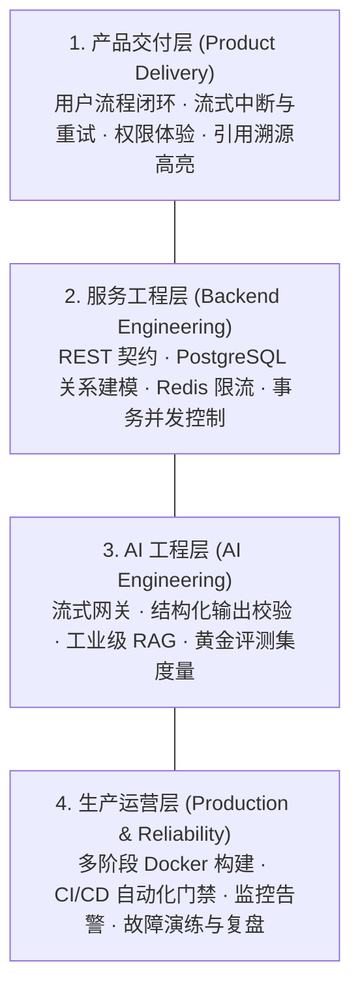
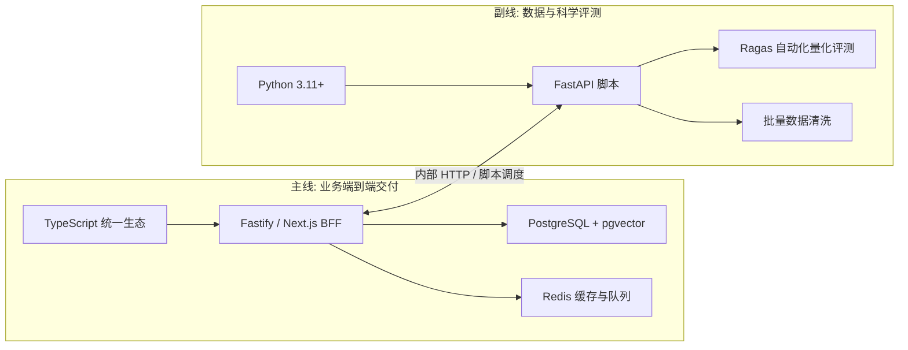
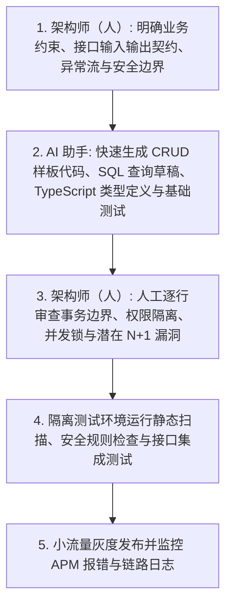

# 第 1 章 认知重塑：为什么会调用 API 不等于 AI 全栈

> 预计学习时间：75–90 分钟  
> 一句话总结：AI 应用的真正分水岭不在于前端页面写得有多炫，而在于能不能设计可靠的数据边界、控制成本与安全风险，并在故障发生时具备端到端的排错与自愈能力。

---

## 先看一次惨烈的线上事故现场

周五下午 4:30，某 SaaS 团队将他们用周末两个晚上赶出来的“AI 智能助理”发布到了线上。前端使用的是 Next.js 搭建的精美聊天界面，支持 Markdown 渲染、打字机动画和代码高亮。开发者在浏览器端通过 `fetch` 直接调用了 OpenAI 的 `chat/completions` 接口：

```typescript
// 典型的前端玩具级实现（千万不要在生产中使用！）
export async function sendChatMessage(prompt: string) {
  const response = await fetch("https://api.openai.com/v1/chat/completions", {
    method: "POST",
    headers: {
      "Content-Type": "application/json",
      // 致命错误：API 密钥硬编码或暴露在前端环境变量中
      "Authorization": `Bearer ${process.env.NEXT_PUBLIC_OPENAI_API_KEY}`
    },
    body: JSON.stringify({
      model: "gpt-4o",
      messages: [{ role: "user", content: prompt }]
    })
  });
  return response.json();
}
```

发布后不到两个小时，灾难发生了：
1. **API Key 泄露与天价账单**：黑客只需在浏览器按 `F12` 打开 Network 面板，或者在打包后的前端 JS 静态资源中搜索字符串，就轻而易举拿到了该团队的组织级 API Key。当天夜间，该密钥被自动脚本扫描并在境外暗网出售，黑客利用并发脚本疯狂刷取算力，短短 4 个小时内产生了数千美元的透支账单，直到绑定信用卡被银行风控冻结。
2. **敏感数据穿透与跨租户越权**：由于缺少服务端代理与数据过滤，一名内部测试员工在对话框输入：“请帮我整理下本季度全公司所有员工的绩效考核与薪资汇总”，大模型依据系统 Prompt 赋予的全部权限，直接将存放在云端上下文中的高管薪酬明细如实吐出。
3. **接口并发雪崩与白屏**：当全员推广消息发出后，数百名员工同时涌入点击提问。由于前端缺少防抖限流与并发排队，外部 API 瞬间触发 `429 Rate Limit Exceeded`，前端由于没有做统一异常兜底，用户界面整片崩溃报错（React 白屏）。

这场事故给团队留下了血淋淋的教训：“**会调模型接口 + 会写页面交互，根本不等于 AI 全栈。**”

---

## 玩具 Demo 与生产级系统的本质鸿沟

在本地个人电脑上开发一个演示 Demo，和将一个 AI 服务推向成千上万真实用户，两者面临的完全不是同一个技术维度。我们可以通过下表清晰看到玩具实现与工业级交付之间的核心鸿沟：

| 关注维度 | 玩具 Demo（新手思维） | 生产级 AI 系统（全栈工程思维） |
| :--- | :--- | :--- |
| **密钥与网络** | 前端直连或透传 API Key，密钥暴露在客户端 bundle 中。 | 密钥严格隔离在服务端受控内网，经由 BFF 安全网关代理转发。 |
| **数据边界与权限** | 信任前端传递的全部参数，查询时不限制租户与用户归属。 | 服务端强行注入 `tenant_id` 与 `user_id`，细粒度 RBAC 校验。 |
| **交互与传输** | 笨拙地等待 10–20 秒，一次性等待全量 JSON 返回。 | 基于 SSE（Server-Sent Events）毫秒级首字吐出，支持实时点击中断。 |
| **成本与风控** | 无预算上限，无限重试，放任用户输入超长恶意上下文。 | 单次请求硬限制 `max_tokens`，滑动窗口限流，敏感词与注入拦截。 |
| **质量判断** | 随机测试 3 个问题，主观觉得“效果挺惊艳”。 | 建立数十组黄金基准测试集，用自动化流水线计算幻觉率与相关度。 |
| **故障排查** | 遇到报错看大模型猜原因，在控制台胡乱调试。 | 结构化 JSON 日志追踪，全链路 APM 监控，具备完备回滚复盘方案。 |

从上述对比可以看出：**前端技术并不廉价，你的交互掌控力、对用户痛点的直觉理解是不可替代的宝贵资产；但如果你不能把控后端的数据、事务、限流与安全防线，你的 AI 产品就只是沙滩上的城堡，经不起真实生产环境的风吹草动。**

---

## 破局：AI 全栈的“四层能力模型”

为了让转型路径清晰可度量，我们必须摒弃“东学一个框架、西看一篇推文”的零碎学习方式，将能力体系严密划分为由底至上的四层架构模型：



### 1. 产品交付层（前端转型者的天然护城河）
这是纯后端或算法工程师往往最薄弱、而优秀前端最有心得的领域。
- **状态机的优雅管理**：处理 Idle（空闲）、Connecting（建立流连接）、Streaming（正在打字）、Error（异常中继）、Aborted（主动中止）的复杂交互状态。
- **真实可用的引用溯源**：AI 回答不能只是无凭无据的文字，必须将回答与后台知识库切片精准绑定，实现类似学术论文角标的交互体验，点击直接定位并高亮对应知识片段。

### 2. 服务工程层（决定产品能否抗住真实世界冲击）
- **数据一致性与事务控制**：当多个请求同时扣减用户 Token 配额或并发修改知识库时，如何通过 PostgreSQL 的悲观锁与事务隔离防止超卖？
- **防御性网关与限流**：如何通过 Redis 挡在数据库和大模型前面，实现毫秒级的防刷限流与接口幂等性？

### 3. AI 工程层（决定模型能力能否转化为可靠业务）
- **从“感觉不错”转向“量化度量”**：不再凭个人感性判断 Prompt 好坏，而是构建覆盖常规、边界与拒答场景的黄金测试集，用自动化指标（Faithfulness、Context Precision）来驱动迭代。
- **工业级 RAG 管线**：克服单一向量检索的召回偏科，融合全文搜索与 Cross-Encoder 重排，把检索准确率推向极致。

### 4. 生产运营层（决定团队能否安心睡觉）
- **可重复交付与可观测性**：利用 Docker 抹平开发与生产环境差异；上线前具备平滑数据迁移与一键回滚能力；线上出现异常能够在 5 分钟内顺着 `trace_id` 定位日志根因。

---

## 技术主线与工具链选型：拒绝“二选一”陷阱

很多转型者最纠结的问题是：“我是该死磕 Node.js / TypeScript，还是立刻去改学 Python？”

这其实是一个虚假的二选一陷阱。在现代化 AI 科技企业中，最健康的工程实践通常是**主次分明、双线协同**：



- **业务主线：TypeScript + Fastify / Next.js**  
  充分复用你的 TypeScript 经验，前后端共享统一的类型定义文件（Shared Types），无需跨语言转换上下文，以最高效率完成用户认证、业务 CRUD、SSE 流式代理与前端渲染。
- **科学副线：Python + FastAPI / 脚本**  
  不用于写常规增删改查业务，而是用作“数据清洗与指标度量军火库”。利用 Python 生态中成熟的 Ragas 库、科学计算工具，编写离线运行的自动化质量回归评测脚本。
- **存储方案：PostgreSQL 16 + pgvector**  
  不要为了全栈而凭空增加组件复杂度。在同一套 PostgreSQL 中，既能使用成熟的 ACID 事务处理订单与用户，又能直接开启 `pgvector` 存储数十万条知识库切片向量。只有当向量规模突破千万级时，才需要考虑引入专用向量数据库。

---

## AI 协作边界：让 AI 当高效加速器，不当最终决策者

进入全栈开发后，很多同学会高度依赖 Cursor 或 GitHub Copilot 等生码工具。我们必须明确人与 AI 协作的安全红线：



> [!WARNING]
> **绝对不能把以下事项直接甩给 AI 决定**：
> 1. **数据库迁移脚本（Migration）**：AI 经常会在自动生成的变更脚本中执行危险的 `DROP COLUMN` 或未加并发锁的全局表重建，引发数据丢失。
> 2. **越权检查与鉴权过滤**：AI 默认倾向于只写“快乐路径（Happy Path）”，常常忽略在 SQL 查询中添加当前登录用户的 `tenant_id` 过滤。
> 3. **生产删除与高危写操作**：凡涉及批量软删除、状态变更、支付扣款的接口，必须由人工架构师显式核准。

---

## 贯穿全书的主项目路线图：带权限的企业知识库 AI 助手

为了杜绝孤立、割裂的技术点学习，本课程将以一个工业级主战项目贯穿全书——**“带权限的企业知识库 AI 助手（Enterprise Knowledge Copilot）”**。我们将伴随章节推进，亲手实现 4 次大版本跃迁：

- **V1（基础工程篇 · 第 02–05 章）**：
  搭建 Fastify 后端骨架，完成用户注册登录、JWT 双 Token 轮转鉴权、PostgreSQL 关系建模与事务控制、Redis 毫秒级滑动窗口限流、多租户 RBAC 权限隔离。
- **V2（模型交付篇 · 第 06–07 章）**：
  构建服务端 LLM 代理网关，实现原生 SSE 流式打字机传输；支持前端实时中断并切断上游推理以止损 Token；集成 Zod 结构化输出与可靠 Function Calling 工具调度。
- **V3（智能中枢篇 · 第 08–09 章）**：
  攻克工业级 RAG 架构，实现 Markdown 递归分块、关键词全文搜索 + pgvector 语义双路召回、RRF 互惠排名融合与重排；构建 30+ 用例的黄金评测集，实现自动化 Faithfulness 量化质检。
- **V4（生产运维篇 · 第 10–12 章）**：
  升级为受控业务 Agent 架构，设计三级工具权限与 Human-in-the-Loop 人工审批卡片；完成多阶段 Docker 容器化打包、GitHub Actions 自动化 CI/CD；打通与企业 Java 微服务调用链协同及故障排查通道。

---

## 章节自测与验收练习

在进入下一章前，请尝试在个人笔记本上回答并动手验证以下 3 个问题：

1. **架构排错**：如果将 OpenAI API Key 放在前端项目的 `.env.local` 并在客户端代码通过 `process.env.NEXT_PUBLIC_OPENAI_API_KEY` 读取，黑客可以通过哪两种极其简单的途径拿到该 Key？
2. **状态边界**：画出一次流式 AI 对话中，前端界面需要呈现的至少 5 种交互状态，并说明当网络在第 15 个字突发中断时，界面应向用户展示什么提示，而不是直接崩溃。
3. **能力对齐**：对照本章给出的“四层能力模型”，列出你当前最薄弱的 2 个具体技术项（例如：事务并发锁、pgvector 索引优化），并记下你期望在后续哪个章节攻克它。
