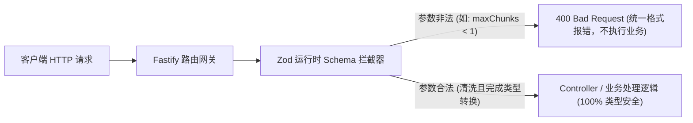
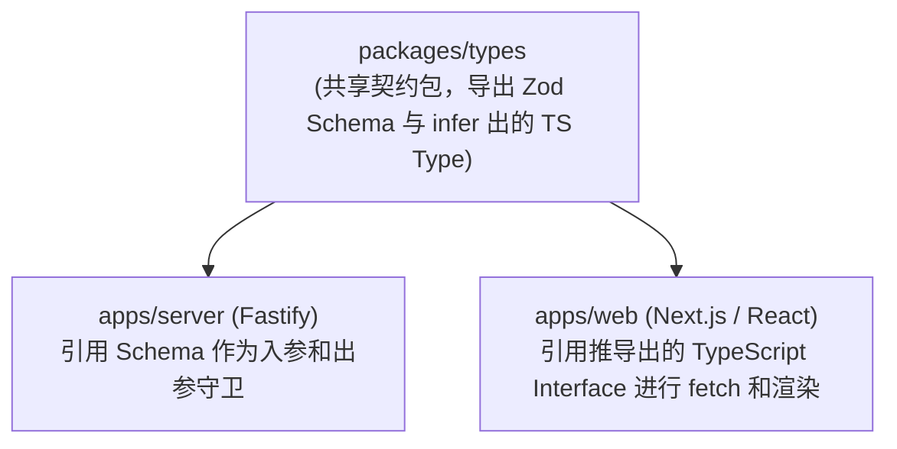

# 第 2 章 服务端工程基石：REST 规范、参数校验与端到端类型契约

> 预计学习时间：80–100 分钟  
> 一句话总结：TypeScript 的类型检查只存在于编译期；生产级后端的第一道防线，是用 Schema 守门员将不可信的外部输入在运行时拦截在业务逻辑之外，并构建端到端不走样的类型契约。

---

## 为什么很多前端转后端的接口“一测就崩”

前端开发者刚涉足服务端开发时，最习惯做的事情就是将前端收到的参数“裸传”给内部函数或数据库：

```typescript
// 典型的不安全后端实现
app.post("/api/documents", async (req, res) => {
  const { title, content, maxChunks } = req.body;
  // 危险：完全没有校验 maxChunks 是否是数字、是否是负数、是否是极大值
  const result = await documentService.create(title, content, maxChunks);
  res.send(result);
});
```

当黑客向该接口发送 `{ "maxChunks": "99999999" }` 或 `{ "maxChunks": -1 }` 时，服务轻则抛出未捕获的运行时异常（`Unhandled Exception`）导致进程退出，重则引发死循环、耗尽系统内存。

> [!IMPORTANT]
> **TypeScript 编译期的“伪安全”陷阱**：  
> 在代码里写了 `interface CreateDocDto { maxChunks: number }`，并不代表传入的 `req.body` 就一定是数字。在编译为 JavaScript 后，所有的 interface 和 type 都会被完全抹除。任何外部网络输入（Query、Params、Body、Headers）在运行时本质上都是不可信的、未经清洗的字符串或松散对象。

因此，生产级服务端的第一准则：**所有输入必须在抵达业务核心前，经过强类型的运行时 Schema 校验。**

---

## 选型思考：为什么主线推荐 Fastify 而非老牌 Express

在 Node.js 生态中，Express 曾是绝对霸主，但对于现代 AI 全栈开发而言，**Fastify** 展现出了压倒性的工程优势：

| 特性对比 | Express 4.x / 5.x | Fastify 4.x / 5.x | NestJS |
| :--- | :--- | :--- | :--- |
| **吞吐量性能** | 中等（底层历史包袱重） | 极高（比 Express 快 2–4 倍，JSON 序列化深度优化） | 视底层驱动而定（默认基于 Express 或 Fastify） |
| **Schema 首发支持** | 无内置，需手动引入第三方中间件组合 | 原生内置 JSON Schema / Ajv 验证与快速序列化 | 基于 TypeScript 装饰器与 class-validator |
| **心智负担** | 极低，但缺乏现代化规范引导 | 轻量、现代，插件机制清晰解耦 | 较重（大量的 Java 风格注解、IoC 容器概念） |
| **生态适合度** | 传统老项目居多 | 现代化轻量全栈、微服务、AI 代理网关的首选 | 大型企业级重度架构团队 |

对于从前端进阶的全栈工程师，Fastify 既保留了原生异步与中间件的直观直率，又提供了工业级的性能与原生 Schema 校验体系。

---

## 运行时 Schema 校验实战：Zod 与 TypeBox 守门员

在 Fastify 中，我们可以通过 `zod`（结合 `fastify-type-provider-zod`）在单处定义中，**同时获得运行时强校验与编译期 TypeScript 类型推导**，杜绝重复书写类型。



### 1. 初始化 Fastify 与类型提供器

首先看核心服务端骨架代码：

```typescript
import Fastify from "fastify";
import { 
  serializerCompiler, 
  validatorCompiler, 
  ZodTypeProvider 
} from "fastify-type-provider-zod";
import { z } from "zod";

// 创建 Fastify 实例并启用结构化日志
export const app = Fastify({
  logger: {
    level: process.env.NODE_ENV === "production" ? "info" : "debug",
    transport: process.env.NODE_ENV !== "production" 
      ? { target: "pino-pretty" } 
      : undefined,
  },
}).withTypeProvider<ZodTypeProvider>();

// 注入 Zod 校验器与序列化编译器
app.setValidatorCompiler(validatorCompiler);
app.setSerializerCompiler(serializerCompiler);
```

### 2. 定义业务 Schema 并编写路由

以企业知识库创建文档接口为例，定义严格的校验规则：

```typescript
// 定义入参与响应的 Zod Schema
const CreateDocumentSchema = {
  body: z.object({
    title: z.string().trim().min(2, "标题至少需要 2 个字符").max(100, "标题不能超过 100 字符"),
    content: z.string().min(10, "正文内容不能少于 10 个字符"),
    category: z.enum(["engineering", "hr", "finance", "legal"], {
      errorMap: () => ({ message: "分类必须为 engineering/hr/finance/legal 之一" }),
    }),
    tags: z.array(z.string()).max(5, "最多添加 5 个标签").default([]),
  }),
  response: {
    201: z.object({
      code: z.literal(0),
      message: z.string(),
      data: z.object({
        id: z.string().uuid(),
        title: z.string(),
        createdAt: z.string(),
      }),
    }),
  },
};

// 注册路由
app.post(
  "/api/v1/documents",
  { schema: CreateDocumentSchema },
  async (request, reply) => {
    // 此时 request.body 拥有完整的类型提示，且已被清洗（如 title 去除了首尾空格）
    const { title, content, category, tags } = request.body;

    // 模拟存入数据库
    const newDoc = {
      id: "9b1deb4d-3b7d-4bad-9bdd-2b0d7b3dcb6d",
      title,
      createdAt: new Date().toISOString(),
    };

    return reply.status(201).send({
      code: 0,
      message: "文档创建成功",
      data: newDoc,
    });
  }
);
```

---

## 统一响应封套与全局异常拦截器

真实生产系统中，绝对不能把原始的未处理异常（堆栈信息）直接吐给客户端，否则不仅破坏前端处理逻辑，还会暴露内部代码目录结构等安全机密。

### 1. 标准业务响应契约：`Result<T>`

```typescript
export interface Result<T> {
  code: number;       // 0 代表成功，非 0 代表具体业务错误码
  message: string;    // 人类可读的友好提示
  data: T | null;     // 业务数据载体
  traceId?: string;   // 链路追踪 ID，便于排查线上问题
}
```

### 2. 编写全局异常处理器 (Global Error Handler)

```typescript
import { FastifyError, FastifyReply, FastifyRequest } from "fastify";
import { ZodError } from "zod";

export class BusinessException extends Error {
  constructor(public code: number, message: string) {
    super(message);
    this.name = "BusinessException";
  }
}

app.setErrorHandler((error: FastifyError, request: FastifyRequest, reply: FastifyReply) => {
  const traceId = request.id; // Fastify 自动生成的请求唯一标识

  // 1. 处理 Zod 参数校验失败
  if (error instanceof ZodError || (error as any).validation) {
    request.log.warn({ traceId, err: error }, "入参校验失败");
    return reply.status(400).send({
      code: 40001,
      message: "请求参数不合法: " + (error as any).issues?.map((i: any) => i.message).join("; "),
      data: null,
      traceId,
    });
  }

  // 2. 处理已知业务异常
  if (error instanceof BusinessException) {
    request.log.info({ traceId, code: error.code, msg: error.message }, "业务受控异常");
    return reply.status(200).send({
      code: error.code,
      message: error.message,
      data: null,
      traceId,
    });
  }

  // 3. 处理未知未捕获严重异常 (500)
  request.log.error({ traceId, err: error }, "服务端发生未捕获异常");
  return reply.status(500).send({
    code: 50000,
    message: "系统繁忙，请稍后重试",
    data: null,
    traceId,
  });
});
```

---

## 前后端端到端类型共享架构

在全栈开发中，最痛苦的事情莫过于后端修改了一个字段名称，前端不知情依然使用老字段，直到运行报错。通过 Monorepo 或共享包，我们可以让前后端实现**单源类型真理（Single Source of Truth）**。



在共享包中直接导出：
```typescript
// packages/types/src/document.ts
import { z } from "zod";

export const CreateDocInputSchema = z.object({
  title: z.string().min(2),
  content: z.string().min(10),
});

// 从 Schema 自动推导出 TypeScript 类型，绝不手写第二遍！
export type CreateDocInput = z.infer<typeof CreateDocInputSchema>;
```

在前端 React 代码中直接复用：
```typescript
import type { CreateDocInput, Result } from "@my-copilot/types";

export async function submitDocument(payload: CreateDocInput): Promise<Result<{ id: string }>> {
  const res = await fetch("/api/v1/documents", {
    method: "POST",
    headers: { "Content-Type": "application/json" },
    body: JSON.stringify(payload),
  });
  return res.json();
}
```
此时，一旦你在后端 Schema 中修改或删除了 `title` 字段，前端调用处会**在代码编辑器内立即标红报错**，在编译阶段就提前扼杀接口不一致风险。

---

## 边界误区与排错排查清单

### 1. 常见陷阱
- **陷阱一：直接在路由处理函数中写 `try...catch` 然后什么都不抛**  
  将错误吞掉并返回 `undefined`，导致客户端一直处于 Pending 状态直到超时。应该让异常向上冒泡给全局 `setErrorHandler` 统一处理。
- **陷阱二：分页参数只支持 `offset`**  
  在数据量超十万时，`LIMIT 20 OFFSET 50000` 会导致数据库进行全表顺序扫描。针对大数据量列表，应预先支持基于游标（Cursor-based Pagination）的分页模式。

### 2. 接口自检清单
- [ ] 所有 `POST`、`PUT`、`PATCH` 接口是否对 Body 做了强类型 Schema 校验？
- [ ] 查询列表接口是否设置了最大 `limit` 上限（如强制限制 `limit <= 100`，杜绝用户单次拉取 10 万条拖垮数据库）？
- [ ] 响应中是否剔除了敏感字段（如用户的 `password_hash`、内部密钥等）？
- [ ] 每个异常响应是否都携带了全局唯一的 `traceId`，方便在日志系统中追踪？

---

## 课后迁移实践任务

1. **环境准备与启动**：在本地初始化一个 Fastify + TypeScript 项目，安装 `zod` 与 `fastify-type-provider-zod`。
2. **编写测试接口**：编写一个“根据关键词搜索文档列表”的 GET 接口 `/api/v1/documents/search`，要求使用 Zod 校验 Query 参数：
   - `keyword`：必填，长度在 1 到 50 个字符之间。
   - `page`：数字，默认为 1，必须大于等于 1。
   - `pageSize`：数字，默认为 20，取值范围必须在 5 到 50 之间。
3. **异常拦截测试**：编写一段自动化脚本，传入 `{ page: 0, pageSize: 999 }`，断言接口返回 HTTP 400，且响应结构符合全局统一封套 `Result<T>`。
