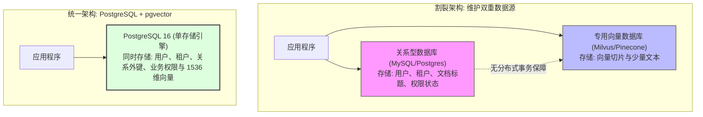
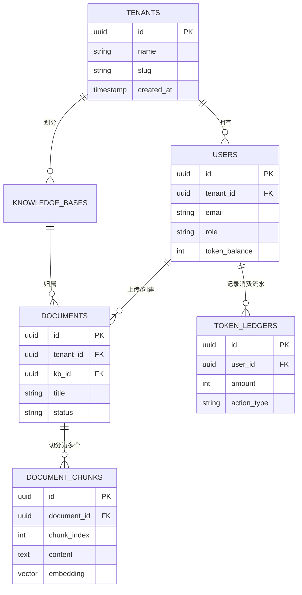

# 第 3 章 核心数据存储：PostgreSQL 关系建模、事务与 pgvector 向量扩展

> 预计学习时间：90–120 分钟  
> 一句话总结：存储是全栈工程的根基。在企业知识库中，将业务元数据与向量数据割裂存放在两个数据库，会带来致命的事务一致性与权限同步灾难；PostgreSQL + pgvector 是十万到数百万切片规模下最优雅的高可用架构基石。

---

## 选型辨析：专用向量库 vs PostgreSQL + pgvector

在 AI 概念刚火爆时，很多团队盲目跟风引入了 Pinecone、Milvus 或 Qdrant 等专用向量数据库。然而，当应用真正接入企业生产环境时，一系列沉重的架构隐患接踵而至：



### 割裂架构的四大致命痛点

1. **分布式事务缺失与数据孤岛**：当用户在管理后台点击“删除这篇技术文档”时，关系库删除了文档记录，但由于网络闪断或进程中断，专用向量库中的向量切片删除失败。结果是：后续普通用户在 AI 问答时，大模型仍然会搜出早已废弃的敏感内容！
2. **权限过滤与连表查询灾难**：知识库通常有严格的部门权限（如“仅研发部可见”、“仅管理层可见”）。在专用向量库中，元数据过滤（Metadata Filtering）性能极其低下；而在 PostgreSQL 中，只需一条 `JOIN` 语句或简单的 `WHERE tenant_id = $1 AND department_id IN (...)` 即可在毫秒级内完成带权限的物理过滤。
3. **备份与灾备恢复复杂度翻倍**：运维需要分别制定关系库的逻辑备份与向量库的物理快照，两者的备份时点无法完全对齐，一旦发生容灾恢复，数据必然出现不一致。
4. **组件运维成本与资源浪费**：引入一套高可用的 Milvus 集群，需要额外维护 etcd、MinIO、Pulsar 等众多重型中间件，部署与监控成本高昂。

> [!TIP]
> **黄金工程法则**：在系统切片数据量未达到数千万级之前，**首选 PostgreSQL + pgvector**。它让你在同一个事务内同时操作订单、用户、文档、权限与高维向量，享受成熟的备份、监控与 ACID 事务保障。

---

## 核心数据模型设计：从用户到向量切片

下面是贯穿全书主项目“企业知识库 AI 助手”的核心数据库表结构（DDL 设计）：



### 1. 开启 pgvector 扩展并建表

```sql
-- 1. 在数据库中安装 pgvector 扩展
CREATE EXTENSION IF NOT EXISTS vector;

-- 2. 租户与企业表
CREATE TABLE tenants (
    id UUID PRIMARY KEY DEFAULT gen_random_uuid(),
    name VARCHAR(100) NOT NULL,
    created_at TIMESTAMPTZ NOT NULL DEFAULT NOW()
);

-- 3. 用户表 (带 Token 余额配额)
CREATE TABLE users (
    id UUID PRIMARY KEY DEFAULT gen_random_uuid(),
    tenant_id UUID NOT NULL REFERENCES tenants(id) ON DELETE CASCADE,
    email VARCHAR(255) NOT NULL UNIQUE,
    role VARCHAR(50) NOT NULL DEFAULT 'member', -- admin, member, auditor
    token_balance INT NOT NULL DEFAULT 500000 CHECK (token_balance >= 0),
    created_at TIMESTAMPTZ NOT NULL DEFAULT NOW()
);
CREATE INDEX idx_users_tenant ON users(tenant_id);

-- 4. 知识库主表
CREATE TABLE knowledge_bases (
    id UUID PRIMARY KEY DEFAULT gen_random_uuid(),
    tenant_id UUID NOT NULL REFERENCES tenants(id) ON DELETE CASCADE,
    name VARCHAR(100) NOT NULL,
    description TEXT,
    created_at TIMESTAMPTZ NOT NULL DEFAULT NOW()
);

-- 5. 文档表
CREATE TABLE documents (
    id UUID PRIMARY KEY DEFAULT gen_random_uuid(),
    tenant_id UUID NOT NULL REFERENCES tenants(id) ON DELETE CASCADE,
    kb_id UUID NOT NULL REFERENCES knowledge_bases(id) ON DELETE CASCADE,
    title VARCHAR(255) NOT NULL,
    status VARCHAR(50) NOT NULL DEFAULT 'processing', -- processing, ready, failed
    created_at TIMESTAMPTZ NOT NULL DEFAULT NOW()
);
CREATE INDEX idx_docs_kb ON documents(kb_id);

-- 6. 核心：文档切片表 (携带 1536 维 OpenAI 或 768 维开源 Embedding 向量)
CREATE TABLE document_chunks (
    id UUID PRIMARY KEY DEFAULT gen_random_uuid(),
    tenant_id UUID NOT NULL REFERENCES tenants(id) ON DELETE CASCADE,
    document_id UUID NOT NULL REFERENCES documents(id) ON DELETE CASCADE,
    chunk_index INT NOT NULL,
    content TEXT NOT NULL,
    token_count INT NOT NULL,
    -- 定义 1536 维度的稠密向量字段 (对应 text-embedding-3-small)
    embedding VECTOR(1536) NOT NULL,
    created_at TIMESTAMPTZ NOT NULL DEFAULT NOW(),
    CONSTRAINT uk_doc_chunk UNIQUE(document_id, chunk_index)
);
```

---

## 向量索引深度对比：HNSW vs IVFFlat

如果只是在 `VECTOR(1536)` 字段上直接执行查询，数据库会对全表逐行计算余弦距离（Flat 暴力扫描，精准率 100%，但在超过 5,000 条切片后查询耗时呈线性激增至数百毫秒以上）。

生产级环境必须为向量字段建立**近似最近邻 (ANN, Approximate Nearest Neighbor) 索引**：

| 索引类型 | 算法原理 | 优势 | 劣势 | 推荐场景 |
| :--- | :--- | :--- | :--- | :--- |
| **IVFFlat (倒排平铺文件)** | 将向量聚类为 $N$ 个列表（Centroids），查询时仅扫描距离最近的若干聚类。 | 建立索引速度快，占用内存极小。 | 检索召回率随数据更新容易下降；需要事先有足够训练数据才能建索引。 | 内存极度受限且数据基本不再新增的冷门归档库。 |
| **HNSW (分层导航小世界)** | 构建多层图网络（Skip-List 思维的高维版本），查询时自顶向下逐层快速收敛。 | **查询速度极快，召回率极高（通常 >98%）**；数据动态实时插入不影响质量。 | 建立索引耗时稍长，内存占用约为 IVFFlat 的 2–3 倍。 | **企业级实时知识库的绝对首选标准！** |

### 创建生产级 HNSW 索引

在 PostgreSQL 16 中，创建基于余弦距离度量的 HNSW 索引：

```sql
-- 使用余弦距离算子 vector_cosine_ops
CREATE INDEX idx_chunks_hnsw_cosine ON document_chunks 
USING hnsw (embedding vector_cosine_ops)
WITH (
    m = 16,               -- 每个节点的最大双向连接数 (通常取 16~64，越大图越密，召回越高)
    ef_construction = 64  -- 构建索引时的动态搜索候选数 (通常取 64~128)
);
```

### 检索向量的 SQL 语法与执行计划

在 PostgreSQL 中，pgvector 提供了三种标准的距离计算操作符：
- `<=>`：余弦距离（Cosine Distance，范围 $0 \sim 2$，值为 0 代表完全相同，最常用）
- `<->`：欧氏距离（L2 / Euclidean Distance）
- `<#>`：点积负值（Negative Inner Product）

```sql
-- 执行带租户权限过滤的向量 Top-K 检索
EXPLAIN ANALYZE
SELECT 
    id,
    document_id,
    chunk_index,
    content,
    -- 将余弦距离转换为 0~1 的相似度打分 (1 - distance)
    1 - (embedding <=> '[0.012, -0.045, 0.089, ...]'::vector) AS similarity
FROM document_chunks
WHERE tenant_id = 'c12f458e-0b0c-4d3e-953e-51c36b856a9a'
ORDER BY embedding <=> '[0.012, -0.045, 0.089, ...]'::vector
LIMIT 5;
```

> [!IMPORTANT]
> 通过 `EXPLAIN ANALYZE` 观察执行计划，如果看到 `Index Scan using idx_chunks_hnsw_cosine`，说明成功走上了 HNSW 内存图索引，单次 1536 维度的 Top-5 检索耗时通常可以在 5～15 毫秒以内完成。

---

## 事务与并发控制：悲观锁防超卖实战

AI 问答涉及昂贵的外部 Token 计费。如果用户账户里只剩 1,000 Token 的额度，而该用户在前端疯狂连击或者同时并发发起了 5 个提问，后端如果只做常规的 `if (balance > cost)` 检查，会导致经典的**并发超卖漏洞**：5 个请求同时读到剩余 1,000，各自扣减，最终账户余额被扣成负数。

### 1. 悲观行锁防并发超卖机制

```mermaid
sequenceDiagram
  autonumber
  actor User as 恶意并发用户
  participant Worker1 as 线程 A (提问 1)
  participant Worker2 as 线程 B (提问 2)
  participant DB as PostgreSQL 事务引擎

  User->>Worker1: 发起问答 A (需扣 800 Token)
  User->>Worker2: 发起问答 B (需扣 800 Token)
  Worker1->>DB: BEGIN 事务; SELECT balance FROM users WHERE id = $1 FOR UPDATE;
  Note over DB,Worker1: 获得用户行的排他排它锁 (X-Lock)
  Worker2->>DB: BEGIN 事务; SELECT balance FROM users WHERE id = $1 FOR UPDATE;
  Note over Worker2,DB: 线程 B 被数据库挂起阻塞等待...
  Worker1->>Worker1: 校验余额充足 (1000 >= 800)
  Worker1->>DB: UPDATE users SET token_balance = token_balance - 800; COMMIT;
  Note over DB,Worker1: 线程 A 提交事务并释放锁
  Note over Worker2,DB: 线程 B 被唤醒并读取到最新余额 (200)
  Worker2->>Worker2: 校验余额不足 (200 < 800)!
  Worker2->>DB: ROLLBACK;
  Worker2-->>User: 优雅拦截: 40003 余额不足，请充值
```

### 2. Node.js / TypeScript 生产级事务代码实现

```typescript
import { Pool, PoolClient } from "pg";

const dbPool = new Pool({
  connectionString: process.env.DATABASE_URL,
  max: 20, // 严控连接池上限
  idleTimeoutMillis: 30000,
});

export async function deductTokenSafely(
  userId: string,
  estimatedTokens: number
): Promise<{ success: boolean; newBalance?: number; error?: string }> {
  const client: PoolClient = await dbPool.connect();

  try {
    // 开启事务
    await client.query("BEGIN");

    // 关键：使用 SELECT ... FOR UPDATE 加行级悲观锁
    const queryResult = await client.query(
      `SELECT token_balance FROM users WHERE id = $1 FOR UPDATE`,
      [userId]
    );

    if (queryResult.rows.length === 0) {
      await client.query("ROLLBACK");
      return { success: false, error: "用户不存在" };
    }

    const currentBalance = queryResult.rows[0].token_balance;

    if (currentBalance < estimatedTokens) {
      await client.query("ROLLBACK");
      return { success: false, error: `Token 余额不足 (剩余: ${currentBalance}, 需: ${estimatedTokens})` };
    }

    // 执行安全扣减并记录审计账本
    const updateResult = await client.query(
      `UPDATE users 
       SET token_balance = token_balance - $1 
       WHERE id = $2 
       RETURNING token_balance`,
      [estimatedTokens, userId]
    );

    await client.query(
      `INSERT INTO token_ledgers (user_id, amount, action_type)
       VALUES ($1, $2, 'AI_CHAT_PRE_DEDUCT')`,
      [userId, -estimatedTokens]
    );

    // 提交事务，释放锁
    await client.query("COMMIT");

    return { 
      success: true, 
      newBalance: updateResult.rows[0].token_balance 
    };
  } catch (err) {
    // 遇到任何意外，必须强制回滚，防止长事务锁死数据库
    await client.query("ROLLBACK");
    throw err;
  } finally {
    // 严禁忘记释放 client 回连接池！
    client.release();
  }
}
```

---

## 边界误区与排错清单

### 1. 致命误区
- **连接池耗尽死锁（Connection Pool Exhaustion）**：在 `try...catch` 中获取了 `client`，但在异常分支没有走 `finally { client.release(); }`。当发生 20 次未捕获异常后，连接池全部被占满，后续所有 API 都会永远卡死超时。
- **未限定维度的向量插入**：定义了 `VECTOR(1536)`，却把开源 768 维模型的 Embedding 插入，导致底层报错；向量模型一旦选定，维度必须严格对应。

### 2. 数据库性能自检表
- [ ] 向量字段是否建立了 `HNSW` 索引，而非任由系统全表走暴力检索？
- [ ] 知识库检索 SQL 是否携带了 `tenant_id`，且在 `tenant_id` 字段上建立了常规 B-Tree 联合索引？
- [ ] 关键表的主外键级联策略（`ON DELETE CASCADE`）是否明确声明，避免产生孤立悬挂的 Chunk 脏数据？
- [ ] 事务代码块是否保持极其轻量（严禁把耗时数秒的外部 OpenAI fetch 放在 `BEGIN...COMMIT` 数据库事务锁内执行）？

---

## 课后迁移实践任务

1. **容器启动与验证**：使用 Docker 启动一个官方 `pgvector/pgvector:pg16` 容器，连接后执行 `CREATE EXTENSION vector;`。
2. **建表与插入**：创建本章设计的 `document_chunks` 表，为 `embedding` 字段建立 HNSW 余弦索引。
3. **并发扣费模拟验证**：编写一个并发测试脚本（例如利用 `Promise.all` 同时发起 10 个扣减 200 Token 的异步调用），初始余额设为 500 Token。验证在悲观行锁的保护下，最终恰好成功 2 笔，失败 8 笔，余额精准归零且绝不出现负数。
