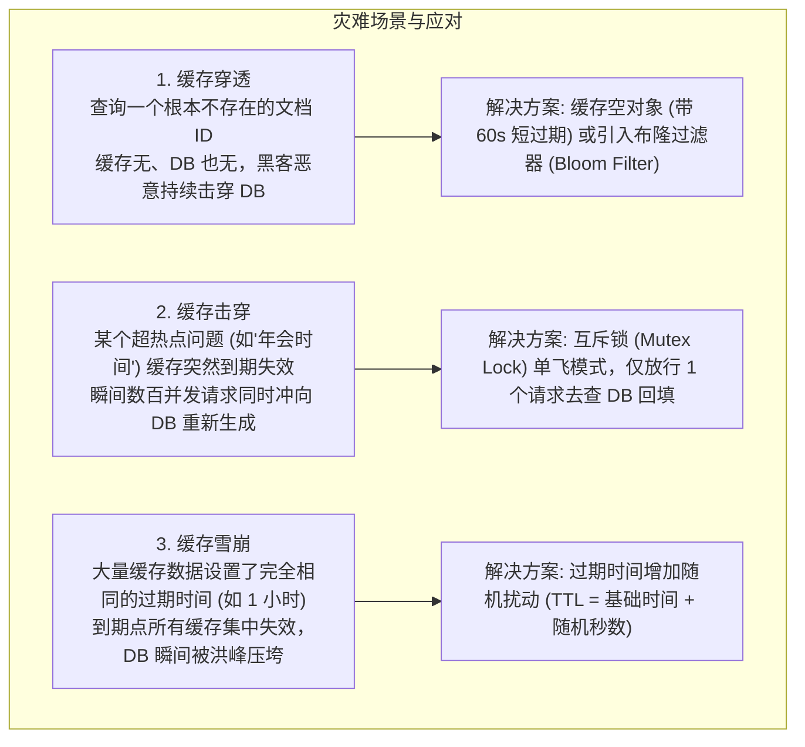
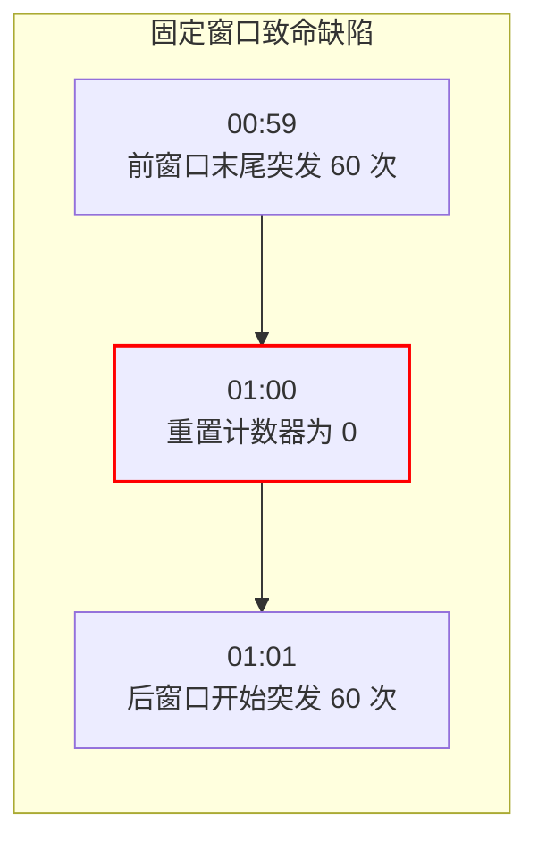
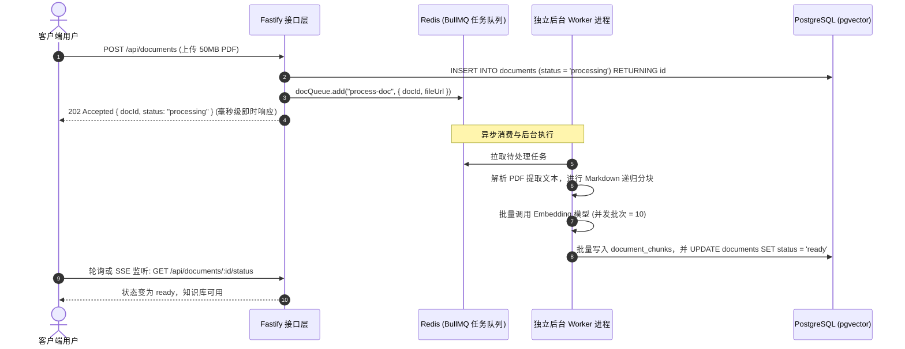

# 第 4 章 高并发护城河：Redis 缓存穿透防御、滑动窗口限流与轻量任务队列

> 预计学习时间：85–105 分钟  
> 一句话总结：外部大模型接口通常存在严重的并发限制与高昂调用计费，单次请求耗时更是长达数秒；Redis 是横亘在前端洪峰流量与脆弱后端之间不可或缺的防洪护城河。

---

## 真实灾难回放：AI 网关如何被瞬时流量击穿

某企业知识库上线首日，HR 部门在内部大群发出了一则通知：“员工考勤新规已上线 AI 知识库，大家有疑问可随时提问！”

几分钟内，数千名员工同时打开网页发起提问。然而仅仅过了 3 分钟，整套系统彻底瘫痪：
1. **数据库连接池被占满打垮**：由于没有做热点缓存，数千个完全相同的提问（如“年假怎么休”）同时打到 PostgreSQL，数据库 CPU 飙升至 100%，连接池瞬间耗尽并拒绝所有新请求。
2. **外部大模型 API 触发 429 熔断**：未经过服务端限流排队，大量请求同时直冲 OpenAI，上游接口返回 `429 Too Many Requests`，整个界面呈现大面积报错。
3. **主进程被重型任务卡死**：有几个员工尝试上传了 50MB 的大型 PDF 手册，服务端直接在主 HTTP 响应线程里同步做文件清洗、字符切块与批量 Embedding 计算，导致单次 HTTP 请求耗时超过 60 秒，网关触发 Nginx 504 Gateway Timeout 超时中断。

要彻底解决以上三类工业级痛点，必须熟练掌握 Redis 在**缓存防御、原子限流与异步任务解耦**上的三把斧。

---

## 缓存三大经典灾难与工业级防御策略



### 生产级热点问题缓存实现（带互斥防击穿）

在 AI 知识库中，对于用户问得最多的一致性常见问题（FAQ），建立问答哈希缓存能节省 70% 以上的模型费用与等待时间：

```typescript
import Redis from "ioredis";

export const redis = new Redis(process.env.REDIS_URL || "redis://localhost:6379");

export async function getCachedAnswerWithMutex(
  questionHash: string,
  generateFn: () => Promise<string>
): Promise<string> {
  const cacheKey = `faq:answer:${questionHash}`;
  const lockKey = `lock:faq:${questionHash}`;

  // 1. 尝试从缓存直接读取
  const cached = await redis.get(cacheKey);
  if (cached) {
    return cached;
  }

  // 2. 缓存未命中，尝试获取 Redis 分布式互斥锁 (NX: 只有不存在才设置，EX: 10 秒超时防死锁)
  const acquireLock = await redis.set(lockKey, "locked", "EX", 10, "NX");

  if (acquireLock === "OK") {
    try {
      // 成功获得锁：当前线程负责调用耗时的 LLM 或 DB 生成答案
      const answer = await generateFn();
      
      // 写入缓存，设置随机过期时间防雪崩 (基础 3600 秒 + 随机 0~300 秒)
      const randomTTL = 3600 + Math.floor(Math.random() * 300);
      await redis.set(cacheKey, answer, "EX", randomTTL);

      return answer;
    } finally {
      // 释放锁
      await redis.del(lockKey);
    }
  } else {
    // 未获得锁：说明已有其他并发请求正在生成，短暂休眠 200ms 后重试读缓存
    await new Promise((resolve) => setTimeout(resolve, 200));
    return getCachedAnswerWithMutex(questionHash, generateFn);
  }
}
```

---

## 毫秒级滑动窗口限流：Redis + Lua 脚本实战

很多新手使用的“固定窗口计数器”（例如每分钟最多 60 次），存在严重的**窗口临界突发穿透漏洞**：


在短短 2 秒钟内，实际涌入了 120 次请求，瞬间打垮下游！

### 1. 滑动窗口原理与 Redis ZSET

通过 Redis 的有序集合（Sorted Set / ZSET），将用户的每次请求时间戳记为 `score` 和 `value`。限流逻辑为：
1. 移除集合中“当前时间戳减去窗口大小”之前的所有过期请求。
2. 统计当前集合剩余的成员数量。
3. 若数量小于限制阈值，将本次请求时间戳加入集合并放行；否则拒绝请求。

### 2. 保证原子性的 Lua 脚本实现

由于涉及“删除、计数、插入”多个步骤，必须使用 **Lua 脚本**在 Redis 服务端单线程原子执行，严禁在客户端代码中分多次往返发送 Redis 命令！

```typescript
// sliding_window_ratelimit.lua
const slidingWindowLua = `
local key = KEYS[1]
local now = tonumber(ARGV[1])
local window = tonumber(ARGV[2])
local limit = tonumber(ARGV[3])

local clearBefore = now - window
-- 1. 移除窗口外的过期记录
redis.call('ZREMRANGEBYSCORE', key, '-inf', clearBefore)

-- 2. 统计当前窗口内的请求数
local currentRequests = redis.call('ZCARD', key)

-- 3. 判断是否超限
if currentRequests < limit then
    -- 未超限，记录本次请求 (member 和 score 均使用当前毫秒时间戳)
    redis.call('ZADD', key, now, now)
    -- 设置 key 的过期时间为窗口时长，防止冷门 key 长期占用内存
    redis.call('EXPIRE', key, math.ceil(window / 1000))
    return 1 -- 允许通过
else
    return 0 -- 触发限流拦截
end
`;

export async function checkRateLimit(
  userId: string,
  limit = 20, // 限制 20 次
  windowMs = 60000 // 窗口 1 分钟 (60000ms)
): Promise<{ allowed: boolean }> {
  const key = `ratelimit:user:${userId}`;
  const now = Date.now();

  const result = await redis.eval(
    slidingWindowLua,
    1,
    key,
    now,
    windowMs,
    limit
  );

  return { allowed: result === 1 };
}
```

在 Fastify 接口中间件中使用该限流器：
```typescript
app.addHook("preHandler", async (request, reply) => {
  const userId = request.headers["x-user-id"] as string || request.ip;
  const { allowed } = await checkRateLimit(userId, 30, 60000); // 限制每分钟最多 30 次

  if (!allowed) {
    return reply.status(429).send({
      code: 42900,
      message: "请求过于频繁，请稍后再试",
      data: null,
      traceId: request.id,
    });
  }
});
```

---

## 异步任务解耦：基于 BullMQ 剥离长耗时任务

文档上传、PDF 解析、分块切片与批量调用 Embedding 模型，是典型的**长耗时重型 I/O 任务**（往往需要耗费数十秒至数分钟）。

> [!WARNING]
> **绝对禁止在 HTTP 请求主线程中同步等待文档切片与 Embedding 向量化！**  
> 必须遵循“**立即返回任务 ID，后台异步队列分批消费**”的工业级解耦规范。



### 生产者：立即推入队列并返回任务编号

```typescript
import { Queue } from "bullmq";

export const documentQueue = new Queue("document-processing", {
  connection: { host: "localhost", port: 6379 },
});

// 在 Fastify 路由中：
app.post("/api/v1/documents/upload", async (req, reply) => {
  const { docId, fileUrl } = req.body as any;

  // 1. 将任务丢入 Redis 队列
  await documentQueue.add("parse-and-embed", {
    documentId: docId,
    fileUrl: fileUrl,
    submittedAt: new Date().toISOString(),
  }, {
    attempts: 3, // 失败重试 3 次
    backoff: { type: "exponential", delay: 2000 }, // 指数退避重试
  });

  // 2. 毫秒级给前端返回 202 Accepted
  return reply.status(202).send({
    code: 0,
    message: "文档已加入后台处理队列",
    data: { documentId: docId, status: "queued" },
  });
});
```

---

## 边界误区与排错排查清单

### 1. 生产高频事故
- **Lua 脚本执行超时导致 Redis 阻塞**：Redis 是单线程模型，如果在 Lua 脚本中写了耗时极长或死循环的代码，整个 Redis 实例将被彻底冻结，引发全局大故障。Lua 脚本必须保持简单极速。
- **大 Key 内存溢出**：把整个几兆的 PDF 二进制内容直接作为一个字符串塞入 Redis。Redis 应该只存短文本、元数据、Token 状态或任务上下文，严禁存放大型二进制大对象（Blob）。

### 2. 护城河自检清单
- [ ] 所有对公众开放的 AI 问答接口是否挂载了滑动窗口限流守卫？
- [ ] 缓存写入时是否增加了随机 TTL 扰动，避免同一时刻集中雪崩？
- [ ] 分布式锁是否配置了合理的过期时间（`EX`），防止应用异常崩溃导致锁永远无法释放？
- [ ] 耗时的向量化任务是否已完全移入 BullMQ 等后台队列，主 HTTP 接口响应是否在 200ms 以内？

---

## 课后迁移实践任务

1. **限流脚本压测验证**：在本地启动 Redis，引入本章提供的滑动窗口 Lua 脚本，编写一个压测脚本快速发出 50 次请求（阈值设为 20 次/分钟），确认第 21 到 50 次请求被精确拒绝，且返回状态码均为 429。
2. **防击穿模拟实验**：模拟 5 个并发请求同时访问一个未命中的热点问题，观察日志，验证互斥锁是否成功使得只有一个请求去调用了生成函数，另外 4 个请求均成功复用了前者回填的缓存。
