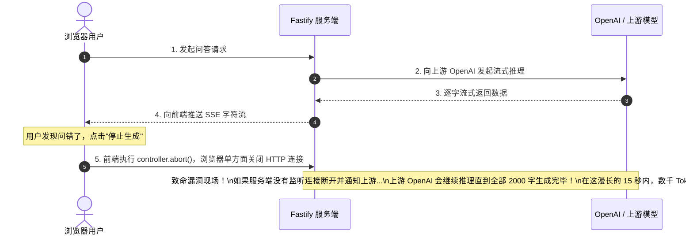

# 第 6 章 生产级 LLM 服务：SSE 流式长连接、AbortSignal 实时中断与代理网关

> 预计学习时间：90–120 分钟  
> 一句话总结：AI 交互体验的分水岭在流式输出，AI 成本控制的分水岭在实时中断；掌握 SSE 协议并与 AbortSignal 全链路联动，是每一个 AI 全栈工程师必须亲手攻克的技术试金石。

---

## 为什么 AI 产品必须使用流式传输

在传统的 Web 开发中，典型的交互流程是“发起请求 -> 等待后台计算完成 -> 返回完整 JSON 响应 -> 前端渲染”。

然而，在大语言模型（LLM）的场景下，这个传统模式会导致极差的用户体验：
- 大模型生成一个 1,000 字的详细回答，底层是由 GPU 逐字进行自回归预测（Autoregressive Generation），总耗时往往长达 **10 到 20 秒**。
- 如果采用传统模式，用户在点击“发送”后，界面会陷入长达十几秒的死寂状态。大部分用户在等待超过 3 秒后就会怀疑系统卡死，进而频繁刷新页面或重复点击，导致后端雪崩。
- **流式传输（Streaming）**通过长连接，在模型吐出第一个字（首字到达时间 TTFT，Time To First Token）的 **300～600 毫秒内**，就立即将字符推送到浏览器屏幕上。用户眼睛看着文字像打字机一样实时流淌，心理上的“等待焦虑”直接被抹平。

---

## 协议选型：为什么是 SSE 而非 WebSocket

在实时通信方案中，前端通常首先想到 WebSocket，但在 LLM 问答场景中，**SSE（Server-Sent Events）**才是业界的绝对事实标准：

| 对比维度 | WebSocket | Server-Sent Events (SSE) |
| :--- | :--- | :--- |
| **通信方向** | 全双工（双向均可频繁推送，如多人网游、实时协同白板） | 单向（客户端发起一次标准 HTTP 请求，服务端持续单向推送流） |
| **底层协议** | 独立的 `ws://` 协议，需协议升级握手，可能被防火墙/公司内网代理拦截 | 原生标准 HTTP/1.1 或 HTTP/2，穿透性极好，兼容所有现有网关 |
| **实现复杂度** | 较高（需单独管理长连接心跳 ping/pong、重连逻辑、分布式 Socket 路由） | 极低（本质就是一个不会立即关闭的普通 HTTP 响应，轻量优雅） |
| **断线自动重连** | 需客户端手写重连与心跳保活逻辑 | 浏览器规范内置自动重连与 `Last-Event-ID` 续传机制 |
| **场景适配度** | 适合频繁双向交互 | **完美契合“用户提问一次，模型持续吐字”的 AI 问答场景** |

### SSE 文本协议格式详解

SSE 的协议规范极其清晰简单：
1. 响应头必须声明：
   ```http
   Content-Type: text/event-stream; charset=utf-8
   Cache-Control: no-cache, no-transform
   Connection: keep-alive
   ```
2. 服务端推送的数据块由纯文本构成，字段以冒号分隔，每个独立消息以**两个换行符 `\n\n` 结尾**：
   ```http
   event: message
   data: {"delta": "你"}

   event: message
   data: {"delta": "好"}

   event: message
   data: [DONE]
   
   ```

---

## 致命隐患：前端点击“停止生成”，后端为何还在疯狂扣费？

这是 90% 转型开发者在上线第一个 AI 项目时都会踩入的巨额成本陷阱：



> [!WARNING]
> **千万注意**：前端调用 `AbortController.abort()` 只是断开了“浏览器到你的 Node.js 服务端”之间的 TCP 连接。**如果你没有在服务端捕获这个断开事件，并联动取消“Node.js 到上游 OpenAI”的推理请求，上游大模型是完全不知道客户端已经放弃的！** 它会默默把剩下的几千字全部生成并计费完毕，造成天价的无用 Token 浪费。

---

## 服务端生产级实现：SSE 与全链路 AbortSignal 联动

下面是 Fastify 端到端的流式代理网关实现，展示了如何监听客户端断开并联动切断上游模型调用：

```typescript
import { FastifyReply, FastifyRequest } from "fastify";
import OpenAI from "openai";

const openai = new OpenAI({
  apiKey: process.env.OPENAI_API_KEY, // 密钥安全隔离在服务端
});

export async function chatStreamHandler(request: FastifyRequest, reply: FastifyReply) {
  const { prompt } = request.body as { prompt: string };
  const traceId = request.id;

  // 1. 设置标准的 SSE 响应头
  reply.raw.setHeader("Content-Type", "text/event-stream; charset=utf-8");
  reply.raw.setHeader("Cache-Control", "no-cache, no-transform");
  reply.raw.setHeader("Connection", "keep-alive");
  reply.raw.setHeader("X-Accel-Buffering", "no"); // 关键：禁用 Nginx 缓冲区，防止 Nginx 攒满 4KB 才推送

  // 2. 创建用于控制上游 OpenAI 调用的 AbortController
  const upstreamAbortController = new AbortController();

  // 3. 核心机制：监听客户端连接关闭事件 (用户点击中断、关闭网页、网络断开)
  request.raw.on("close", () => {
    if (!request.raw.destroyed) {
      request.log.info({ traceId }, "客户端已主动断开连接，立即掐断上游模型推理！");
      // 触发取消信号，通知 OpenAI 立即停止推理与计费！
      upstreamAbortController.abort();
    }
  });

  try {
    request.log.info({ traceId }, "开始请求上游大模型流式推理...");

    // 4. 将 upstreamAbortController.signal 传入 OpenAI SDK
    const stream = await openai.chat.completions.create(
      {
        model: "gpt-4o",
        messages: [
          { role: "system", content: "你是一个专业高效的知识库助手。" },
          { role: "user", content: prompt },
        ],
        stream: true,
        max_tokens: 1500, // 设置硬上限防刷
      },
      { signal: upstreamAbortController.signal } // 注入取消信号！
    );

    // 5. 遍历异步生成器 (Async Iterator)，逐块刷出到客户端
    for await (const chunk of stream) {
      const deltaContent = chunk.choices[0]?.delta?.content || "";
      if (deltaContent) {
        // 按照 SSE 规范格式化消息并 flush 到网络中
        const ssePayload = `event: message\ndata: ${JSON.stringify({ text: deltaContent })}\n\n`;
        reply.raw.write(ssePayload);
      }
    }

    // 6. 正常生成结束，发送约定的 [DONE] 标识
    reply.raw.write("event: done\ndata: [DONE]\n\n");
    reply.raw.end();
    request.log.info({ traceId }, "流式生成完毕并正常关闭连接");
  } catch (error: any) {
    // 处理因客户端主动中断触发的取消异常
    if (error.name === "AbortError" || upstreamAbortController.signal.aborted) {
      request.log.warn({ traceId }, "上游请求已被成功中断，止损 Token 成功");
      return;
    }

    // 处理其他上游异常
    request.log.error({ traceId, err: error }, "上游模型调用发生异常");
    reply.raw.write(`event: error\ndata: ${JSON.stringify({ message: "模型生成中断，请稍后重试" })}\n\n`);
    reply.raw.end();
  }
}
```

---

## 前端消费闭环：React 自定义 Hook (`useChatStream`)

在前端 React / Next.js 中，优雅处理流式长连接、支持实时取消、打字机动画和错误捕获：

```typescript
import { useState, useRef, useCallback } from "react";

export function useChatStream() {
  const [messages, setMessages] = useState<Array<{ role: string; content: string }>>([]);
  const [isStreaming, setIsStreaming] = useState(false);
  const abortControllerRef = useRef<AbortController | null>(null);

  const sendMessage = useCallback(async (prompt: string) => {
    // 1. 如果有未完成的旧请求，先取消
    if (abortControllerRef.current) {
      abortControllerRef.current.abort();
    }

    const abortController = new AbortController();
    abortControllerRef.current = abortController;

    // 先把用户问题和空的助手回答放入消息列表
    setMessages((prev) => [
      ...prev,
      { role: "user", content: prompt },
      { role: "assistant", content: "" },
    ]);
    setIsStreaming(true);

    try {
      const response = await fetch("/api/v1/chat/stream", {
        method: "POST",
        headers: { "Content-Type": "application/json" },
        body: JSON.stringify({ prompt }),
        signal: abortController.signal, // 将取消控制器绑定到 fetch
      });

      if (!response.ok || !response.body) {
        throw new Error(`HTTP 异常: ${response.status}`);
      }

      // 2. 利用 Web API ReadableStreamDefaultReader 解码字节流
      const reader = response.body.getReader();
      const decoder = new TextDecoder("utf-8");
      let buffer = "";

      while (true) {
        const { value, done } = await reader.read();
        if (done) break;

        buffer += decoder.decode(value, { stream: true });
        
        // 拆分 SSE 行协议 (以 \n\n 划分事件)
        const events = buffer.split("\n\n");
        buffer = events.pop() || ""; // 留下未闭合的半截文本到下一个循环

        for (const event of events) {
          const lines = event.split("\n");
          for (const line of lines) {
            if (line.startsWith("data: ")) {
              const rawData = line.slice(6).trim();
              if (rawData === "[DONE]") {
                setIsStreaming(false);
                return;
              }
              try {
                const parsed = JSON.parse(rawData);
                if (parsed.text) {
                  // 追加增量字符到最后一条助手消息中
                  setMessages((prev) => {
                    const next = [...prev];
                    const lastIdx = next.length - 1;
                    next[lastIdx] = {
                      ...next[lastIdx],
                      content: next[lastIdx].content + parsed.text,
                    };
                    return next;
                  });
                }
              } catch (e) {
                // 忽略非 JSON 行
              }
            }
          }
        }
      }
    } catch (err: any) {
      if (err.name === "AbortError") {
        console.log("用户主动点击了停止生成");
      } else {
        console.error("流式读取异常:", err);
      }
    } finally {
      setIsStreaming(false);
      abortControllerRef.current = null;
    }
  }, []);

  // 3. 供用户界面“停止生成”按钮调用的函数
  const stopGeneration = useCallback(() => {
    if (abortControllerRef.current) {
      abortControllerRef.current.abort();
      abortControllerRef.current = null;
      setIsStreaming(false);
    }
  }, []);

  return { messages, isStreaming, sendMessage, stopGeneration };
}
```

---

## 边界误区与排错清单

### 1. 致命误区
- **Nginx 缓冲区（Proxy Buffering）默认开启**：  
  如果你的生产环境前面架设了 Nginx，而没有在 Nginx 配置中加上 `proxy_buffering off;`，或者服务端没有发送 `X-Accel-Buffering: no` 响应头，Nginx 会默认在内存中积攒满 4KB 文本后才向客户端推送一次，导致打字机效果直接失效，变成“长时间卡顿后突然喷出一大坨字”。
- **连接泄露未关闭**：服务端发送完 `[DONE]` 标识后，忘记执行 `reply.raw.end()`，导致 HTTP 连接一直处于悬挂状态直到网关超时。

### 2. 流式网关自检表
- [ ] 响应头中是否配置了 `X-Accel-Buffering: no` 以防止代理网关缓冲流？
- [ ] 服务端是否监听了 `request.raw.on("close")` 并触发 `upstreamAbortController.abort()`？
- [ ] 前端界面是否有明显的“停止生成”按钮，且在组件卸载（Unmount）时自动调用取消？
- [ ] 是否在服务端为大模型请求设置了 `max_tokens` 与全局单次超时保护（如 30 秒无响应自动熔断）？

---

## 课后迁移实践任务

1. **实时中断验证实验**：在本地运行 Fastify 服务与前端页面，提问一个需要长篇大论的问题（如“请写一篇 2000 字的明朝历史小论文”）。在流式输出第 20 个字时，立即点击“停止生成”按钮。
2. **证据审查**：查看后端 Fastify 控制台，确认是否立即输出了 `"上游请求已被成功中断，止损 Token 成功"`，并打开 OpenAI Dashboard 确认该次调用的 Completion Token 消耗被精准截断在少量字符，而非计费 2000 字。
