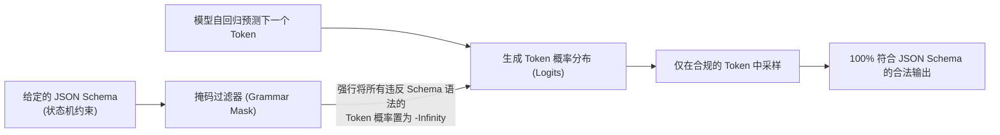
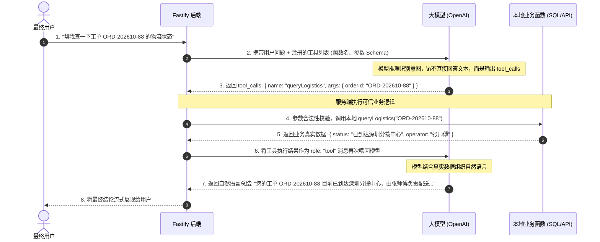

# 第 7 章 结构化输出与受控工具调用：Zod Schema 校验与业务逻辑闭环

> 预计学习时间：80–100 分钟  
> 一句话总结：AI 不再只是陪聊工具，而是业务流程的驱动引擎；通过约束解码获得 100% 可靠的结构化 JSON，并用工具白名单打通业务执行闭环，是构建企业级 AI 应用的核心分水岭。

---

## 为什么说“在 Prompt 里要求只返回 JSON”是极其脆弱的

在早期使用大模型时，很多开发者试图通过调整提示词来提取结构化数据：

```text
请分析以下客户工单，并严格按照 JSON 格式输出结果，不要输出任何多余的废话和解释：
{
  "urgency": "high" | "medium" | "low",
  "category": string,
  "summary": string
}
工单内容：服务器突然不能连接了，请快点处理！
```

然而在真实生产中，你会痛苦地发现，无论你用多么严厉的措辞强调“不要废话”，模型仍然会频繁输出：
- `好的，这是为您提取的 JSON 内容：```json { ... } ``` 祝您生活愉快！`
- 结尾多出一个逗号（Trailing comma）导致 `JSON.parse()` 报语法错误；
- 某些必填字段被随性改名（例如把 `category` 写成 `ticket_type`）。

> [!WARNING]
> 一旦 `JSON.parse()` 发生异常，后端主流程就会直接崩溃抛出 500。在企业业务中，**“95% 的成功率”就等于“5% 的线上重大故障”**。

---

## 原理突破：受限生成（Constrained Decoding）

为什么今天我们能够做到 **100% 格式合规的结构化输出**？这得益于现代主流模型（如 OpenAI、Gemini）在底层推理引擎中引入的**受限生成（Constrained Decoding / Grammar Masking）**技术：



在推理时，模型每预测一个 Token，底层的状态机都会根据我们提供的 JSON Schema 进行语法校验。如果下一个合法的字符必须是引号 `"` 或冒号 `:`，所有非法的汉字或多余字符在底层就被**物理掩码（Mask）屏蔽**了。模型从数学上就不可能输出非法格式。

---

## Zod 驱动的结构化输出实战

结合 `zod` 与 OpenAI SDK 的 `zodResponseFormat`，我们可以极其优雅地完成强类型数据提取：

```typescript
import OpenAI from "openai";
import { z } from "zod";
import { zodResponseFormat } from "openai/helpers/zod";

const openai = new OpenAI({ apiKey: process.env.OPENAI_API_KEY });

// 1. 使用 Zod 定义业务期望的结构化契约
export const CustomerTicketAnalysisSchema = z.object({
  urgency: z.enum(["low", "medium", "high", "critical"], {
    description: "工单紧急程度评估",
  }),
  category: z.enum(["billing", "technical", "account", "feedback"], {
    description: "工单业务分类",
  }),
  sentimentScore: z.number().min(-1).max(1).describe("用户情绪分值，-1 为极度愤怒，1 为非常积极"),
  extractedEntities: z.object({
    orderId: z.string().nullable().describe("提取出的订单号或工单 ID，若无则为 null"),
    userContact: z.string().nullable().describe("联系方式"),
  }),
  actionItems: z.array(z.string()).describe("建议客服立即采取的处理动作列表"),
});

// 自动推导出 TypeScript 类型
export type CustomerTicketAnalysis = z.infer<typeof CustomerTicketAnalysisSchema>;

// 2. 调用模型并开启结构化输出
export async function analyzeTicket(ticketContent: string): Promise<CustomerTicketAnalysis> {
  const completion = await openai.beta.chat.completions.parse({
    model: "gpt-4o-mini", // 结构化提取任务推荐使用轻量高速模型
    messages: [
      {
        role: "system",
        content: "你是一个专业的客服工单智能分类助手。请从用户的原始反馈中精确提取结构化信息。",
      },
      {
        role: "user",
        content: ticketContent,
      },
    ],
    // 关键参数：通过 response_format 传入 Zod Schema
    response_format: zodResponseFormat(CustomerTicketAnalysisSchema, "ticket_analysis"),
  });

  const parsedData = completion.choices[0].message.parsed;
  if (!parsedData) {
    throw new Error("模型拒绝回答或未能解析为结构化数据");
  }

  // 此时 parsedData 拥有 100% 的 TypeScript 类型推导，无需二次手动校验
  return parsedData;
}
```

---

## 受控工具调用 (Tool Calling / Function Calling) 闭环

大模型本身不具备查数据库、发邮件或操作服务器的能力，但它可以通过 **Tool Calling** 充当智能调度中心：



### 生产级工具注册与调度执行器

```typescript
import { ChatCompletionTool } from "openai/resources/chat/completions";

// 1. 定义工具规范 (Tools Definition)
const tools: ChatCompletionTool[] = [
  {
    type: "function",
    function: {
      name: "queryDocDetails",
      description: "根据文档 ID 查询知识库文档的详细元数据与更新时间",
      parameters: {
        type: "object",
        properties: {
          docId: { type: "string", description: "文档的 UUID" },
        },
        required: ["docId"],
        additionalProperties: false,
      },
    },
  },
];

// 2. 本地可信函数实现 (Local Trusted Implementation)
async function executeLocalTool(name: string, argsRaw: string) {
  const args = JSON.parse(argsRaw);
  if (name === "queryDocDetails") {
    // 真正查询数据库，保证数据实时准确
    return await dbPool.query("SELECT id, title, created_at FROM documents WHERE id = $1", [args.docId]);
  }
  throw new Error(`未知的工具名称: ${name}`);
}

// 3. 完整的调用与自闭环调度
export async function runChatWithTools(userPrompt: string) {
  const messages: any[] = [
    { role: "system", content: "你是一个企业助手，必要时可以使用工具查询实时系统数据。" },
    { role: "user", content: userPrompt },
  ];

  // 第一次请求模型
  const firstResponse = await openai.chat.completions.create({
    model: "gpt-4o",
    messages,
    tools,
  });

  const responseMessage = firstResponse.choices[0].message;
  messages.push(responseMessage); // 将模型的响应加入上下文

  // 检查模型是否决定调用工具
  if (responseMessage.tool_calls && responseMessage.tool_calls.length > 0) {
    for (const toolCall of responseMessage.tool_calls) {
      const toolName = toolCall.function.name;
      const toolArgs = toolCall.function.arguments;

      // 服务端执行本地代码
      const executionResult = await executeLocalTool(toolName, toolArgs);

      // 将工具结果回传给上下文 (role 必须为 "tool")
      messages.push({
        role: "tool",
        tool_call_id: toolCall.id,
        content: JSON.stringify(executionResult),
      });
    }

    // 第二次请求模型，生成最终面向用户的自然语言回答
    const finalResponse = await openai.chat.completions.create({
      model: "gpt-4o",
      messages,
    });

    return finalResponse.choices[0].message.content;
  }

  // 若无需调用工具，直接返回文本
  return responseMessage.content;
}
```

---

## 边界误区与排错清单

### 1. 致命误区
- **无限递归死循环（Infinite Tool Calling Loop）**：模型在收到工具执行结果后，由于参数不满意再次触发工具调用，往复循环直至耗尽最大 Token 或请求超时。生产级系统**必须设置最大工具调用轮次（如 `max_tool_rounds = 3`）**，超限立即强制终止。
- **给大模型赋予高危写入工具**：直接将包含 `DROP TABLE`、`DELETE` 或无审核支付的函数暴露给大模型。高危写操作必须引入人工审批（下一阶段 Agent 核心机制）。

### 2. 工具调用自检表
- [ ] 结构化输出是否采用了原生的 `response_format: { type: 'json_schema' }` 或 `zodResponseFormat`？
- [ ] 工具入参在本地执行前是否再次通过 Zod 进行了边界校验，防止模型注入非法 SQL 标识符？
- [ ] 是否为多轮 Tool Calling 配置了单次调用的步数硬上限与总超时时间？
- [ ] 工具调用失败时，是否能将简短的错误信息格式化回填给模型，让其具备解释能力而非直接崩溃？

---

## 课后迁移实践任务

1. **提取测试**：使用本章的 `analyzeTicket` 函数，编写一段批处理脚本，对 5 条不同口吻的用户差评进行结构化分析，打印出提取出的 `urgency`、`sentimentScore` 与 `actionItems`。
2. **工具调度断言**：注册一个名为 `calculateRefundAmount(orderId, reason)` 的工具函数，模拟用户提问“我要退款 ORD-1002，因为商品破损”，断言模型能够精准识别意图并输出正确的函数名与参数。
