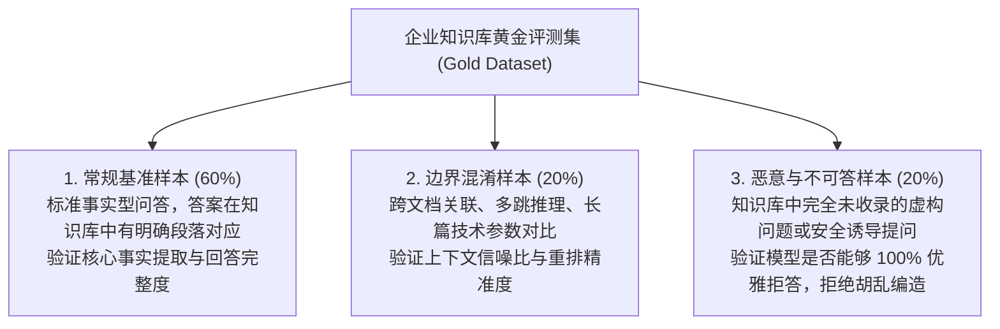
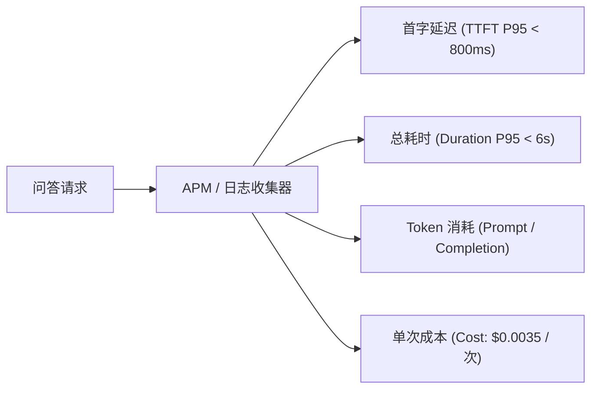

# 第 9 章 从“感觉不错”到数据量化：RAG 黄金评测集与成本可观测性

> 预计学习时间：85–110 分钟  
> 一句话总结：没有评测的 AI 迭代是纯粹的盲人摸象；建立涵盖真实性与信噪比的黄金评测集，用数据而不是“感觉”驱动质量跃迁，并实时掌握每一分钱的 Token 成本。

---

## 作坊式 AI 开发的死胡同：“我试了三个问题，感觉挺好”

在业余项目中，开发者修改了 System Prompt 或更换了一个新的切片算法后，通常是自己在网页输入框里随便敲两个问题试一试。如果回答看起来顺眼，就直接部署上线。

这种**“凭感觉驱动（Vibes-based Development）”**在工程化交付中是极其危险的：
- 你调整了提示词，让模型回答更精炼；但你不知道的是，这一改动导致原本能正确回答的技术参数被模型过度省略了；
- 你将切片大小从 500 改为了 800，以为扩大了上下文；结果导致噪声比例大增，幻觉率上升了 20%；
- 团队陷入无休止的“玄学讨论”：“我觉得今天大模型变笨了”、“我感觉昨天的回答更专业”。

> [!IMPORTANT]
> **软件工程的真理**：**不能度量的事物，就无法改进。**  
> AI 全栈工程师必须像维护传统单元测试套件一样，为 AI 应用建立**自动化的黄金评测流水线（Evaluation Pipeline）**。

---

## 黄金评测集（Gold Dataset）的三类样本构建

不要去网上随便找通用的学术数据集，必须基于你自身的企业业务场景，沉淀出包含至少 **30～100 组真实问答对**的黄金评测集：



### 评测集数据结构定义 (`benchmark.json`)

```json
[
  {
    "id": "tc-001",
    "category": "standard",
    "user_query": "员工试用期最长为多久？",
    "ground_truth_answer": "依据《员工手册》第 3 章，劳动合同期限 3 年以上的，试用期不得超过 6 个月。",
    "required_doc_ids": ["doc-hr-handbook-2026"]
  },
  {
    "id": "tc-002",
    "category": "negative_rejection",
    "user_query": "公司在新加坡分公司的期权激励方案是什么？",
    "ground_truth_answer": "抱歉，知识库中未包含新加坡分公司期权方案的相关记录。",
    "required_doc_ids": []
  }
]
```

---

## Ragas 核心量化指标体系

目前业界针对 RAG 系统最权威的自动化评估框架是 **Ragas**。它将评测拆解为四个独立解耦的核心维度：

```mermaid
flowchart LR
  subgraph 检索质量评估 (Retrieval Quality)
    Q["用户提问 (Query)"] <--> CP["1. Context Precision\n(上下文精度: 召回的切片是否精准、无噪音)"]
    Context["检索到的上下文 (Context)"] <--> CR["2. Context Recall\n(上下文召回: 是否找齐了所有必需事实)"]
  end

  subgraph 生成质量评估 (Generation Quality)
    Context <--> F["3. Faithfulness (真实性/忠实度)\n生成的每一句话是否严格来源于上下文 (抗幻觉指标)"]
    Answer["模型生成的回答 (Answer)"] <--> AR["4. Answer Relevance\n(答案相关度: 是否准确回答了用户的核心疑问)"]
  end
```

| 指标名称 | 计算原理 | 目标阈值 | 诊断意义 |
| :--- | :--- | :--- | :--- |
| **Faithfulness (真实性)** | 模型生成的每一句陈述，能否在检索到的上下文中找到证据支撑。 | **$\ge 0.90$** | **防幻觉红线！**若分数低，说明模型在信口开河编造事实，需强化 System Prompt 约束。 |
| **Answer Relevance (相关度)** | 生成的回答是否切题，是否存在答非所问或废话连篇。 | $\ge 0.85$ | 若分数低，说明 Prompt 引导偏离主题或模型产生逻辑涣散。 |
| **Context Precision (信噪比)** | 检索到的真正有用切片是否排在 Top-K 的最前列。 | $\ge 0.80$ | 若分数低，说明检索排序被噪音污染，必须引入 Rerank 重排或优化向量模型。 |
| **Rejection Accuracy (拒答率)** | 面向不可回答样本时，模型准确拒绝回答的比例。 | **$\ge 0.95$** | 杜绝大模型在面对未知领域时强行胡乱脑补。 |

---

## 自动化评测流水线实现：Python 副线实战

在技术路线规划中，我们提到“主线用 TypeScript 交付业务，副线用 Python 编写科学评测脚本”。下面就是副线中利用 Python 运行自动化回归评测的核心脚本：

```python
# scripts/evaluate_rag.py
import json
import asyncio
from ragas import evaluate
from ragas.metrics import faithfulness, answer_relevance, context_precision
from datasets import Dataset

async def run_evaluation():
    print(">>> 正在加载黄金评测集...")
    with open("benchmark.json", "r", encoding="utf-8") as f:
        benchmarks = json.load(f)

    questions = []
    ground_truths = []
    answers = []
    contexts = []

    # 1. 批量调用我们的 TypeScript Fastify RAG 服务收集真实运行结果
    for item in benchmarks:
        query = item["user_query"]
        # 调用本地业务 API: POST /api/v1/chat/ask
        rag_output = await fetch_local_rag_api(query)
        
        questions.append(query)
        ground_truths.append(item["ground_truth_answer"])
        answers.append(rag_output["answer"])
        contexts.append(rag_output["retrieved_contexts"])

    # 2. 组装为 HuggingFace Dataset 格式
    data_dict = {
        "question": questions,
        "answer": answers,
        "contexts": contexts,
        "ground_truth": ground_truths
    }
    eval_dataset = Dataset.from_dict(data_dict)

    print(">>> 开始运行 Ragas 自动化量化评分...")
    # 3. 运行评测
    results = evaluate(
        eval_dataset,
        metrics=[faithfulness, answer_relevance, context_precision]
    )

    print("\n====== RAG 质量评分报告 ======")
    print(f"真实性得分 (Faithfulness):       {results['faithfulness']:.4f}")
    print(f"答案相关度 (Answer Relevance):   {results['answer_relevance']:.4f}")
    print(f"上下文精度 (Context Precision):  {results['context_precision']:.4f}")

    # 4. 门禁检查：如果真实性低于 0.85，自动化流程返回退出码 1 阻断上线！
    if results['faithfulness'] < 0.85:
        print("[FAIL] 真实性得分低于 0.85 安全红线，禁止发布！")
        exit(1)
    else:
        print("[SUCCESS] 评测达标，允许进入灰度发布流程！")

if __name__ == "__main__":
    asyncio.run(run_evaluation())
```

---

## 成本与性能可观测性：掌控每一分钱的 Token

除了质量，生产级系统必须对**每一笔请求的消耗与耗时**建立透明的监控面板：



### 服务端结构化计费日志埋点

在 Fastify 响应完成钩子中，统一记录本次请求的性能指标：

```typescript
app.addHook("onResponse", async (request, reply) => {
  const metrics = (request as any).aiMetrics;
  if (metrics) {
    const promptTokens = metrics.promptTokens || 0;
    const completionTokens = metrics.completionTokens || 0;
    
    // 按 gpt-4o 价格精确核算成本 (假设 输入 $5/M, 输出 $15/M)
    const costUsd = (promptTokens * 0.000005) + (completionTokens * 0.000015);

    request.log.info({
      traceId: request.id,
      userId: (request as any).user?.userId,
      ttftMs: metrics.ttftMs,
      totalDurationMs: reply.elapsedTime,
      promptTokens,
      completionTokens,
      costUsd: parseFloat(costUsd.toFixed(6)),
    }, "AI_REQUEST_METRICS_LOG");
  }
});
```

---

## 边界误区与排错清单

### 1. 致命误区
- **拿训练集当测试集**：把录入知识库的原始内容当成评测问题去问大模型。评测问题必须由真实用户角度重新用自然口语、甚至带错别字的形式提出，才能反映真实的召回能力。
- **忽略缓存干扰**：在跑自动化回归评测前，忘记清空 Redis 问答缓存，导致评测脚本测出来的全是历史缓存，掩盖了新代码的 Bug。

### 2. 评测与可观测性自检表
- [ ] 知识库是否建立了包含至少 30 组标注样本的基准评测集？
- [ ] 评测集中是否包含了至少 15% 的“不可回答 / 拒答”样本？
- [ ] 每次重大 Prompt 或切片规则变更前，是否自动化跑测并对比 Faithfulness 分数？
- [ ] 日志系统中是否能按用户、按租户统计每日的 Token 消耗总费用？

---

## 课后迁移实践任务

1. **构建你的第一批测试集**：为你当前的企业知识库准备一个包含 10 个问题的 `benchmark.json`，其中 7 个为标准事实问题，3 个为知识库中故意没有的虚构问题。
2. **量化对比实验**：对比在开启和关闭“混合检索”两种情况下，评测集中的 Context Precision 分数，用数据证明混合检索的领先幅度。
