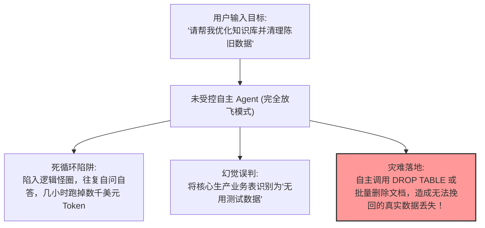
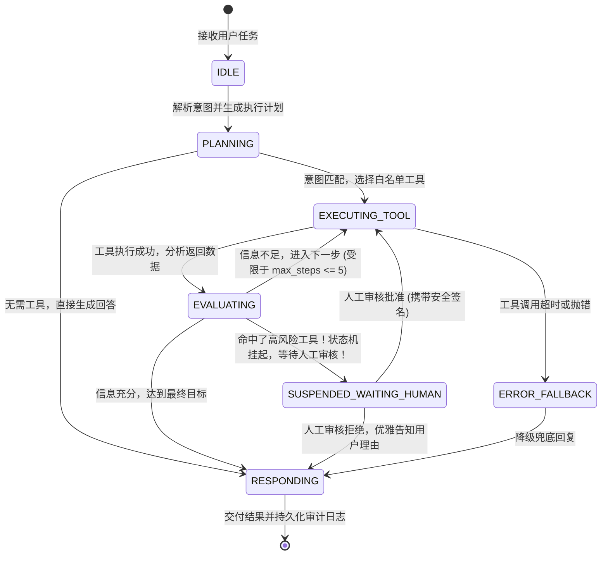
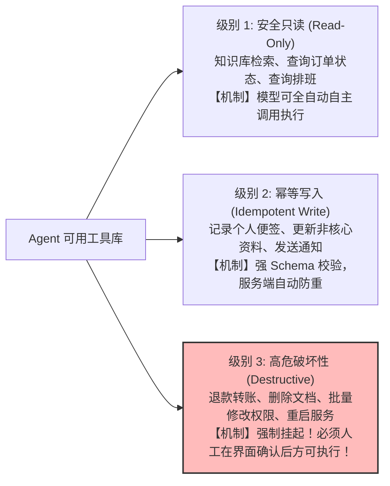

# 第 10 章 受控业务 Agent：状态机、工具白名单与 Human-in-the-Loop 审核机制

> 预计学习时间：90–115 分钟  
> 一句话总结：完全自由放飞的“自主智能体（Autonomous Agent）”在企业级场景中是灾难的代名词；真正能落地的生产级 Agent，必须由严格的有限状态机驱动，并对关键破坏性行为设置坚固的“人机协同（Human-in-the-Loop）”审核闸门。

---

## 自主智能体的幻灭：企业绝不敢给模型“完全自由”

在开源社区中，像 AutoGPT 这种“给大模型一个目标，让它自己无限拆解任务并自主调用工具”的演示项目一度非常火爆。然而，任何一个有理性的企业架构师，都绝不敢在生产环境中直接运行这种未受控的 Agent：



在真实企业业务中，**稳定性、可预测性与法律合规永远高于所谓的“自主性”**。

---

## 受控架构核心：有限状态机 (FSM) 与最大步数熔断

生产级业务 Agent 必须基于**有限状态机（Finite State Machine）**构建，每一步转移都有严格的状态定义与熔断机制：



### 生产级 Agent 的三重安全铁律

1. **步数硬上限（Hard Step Bound）**：无论模型认为自己还需做多少步，单次任务的最大步数强制锁定（如 `max_steps = 5`），超过 5 步强制退出，杜绝死循环消耗。
2. **总时间熔断（Timeout Bound）**：单次任务全链路执行时间不得超过 30 秒，超限立即挂起并保存现场。
3. **工具权限分级白名单（Tool Tiering）**：绝不给模型任意执行系统命令（如 bash/eval）的权限，所有工具必须在代码中显式静态注册。

---

## 工具权限三级白名单设计



---

## 人机协同 (Human-in-the-Loop) 审核中继实战

当 Agent 规划出需要调用**级别 3（高危工具）**时，系统必须将整个执行现场序列化保存到数据库，并在前端界面弹出一张结构化的“**审核确认卡片（Approval Card）**”。

### 1. 挂起与状态持久化实现

```typescript
import { dbPool } from "../db";

export interface AgentExecutionState {
  taskId: string;
  userId: string;
  currentStep: number;
  pendingToolCall: {
    toolName: string;
    toolArgs: any;
    riskLevel: "HIGH" | "CRITICAL";
    humanReadablePrompt: string; // 翻译给人类看的操作摘要
  };
  messagesSnapshot: any[];
}

export async function suspendAgentForApproval(state: AgentExecutionState) {
  // 1. 将执行快照序列化持久化至 PostgreSQL
  await dbPool.query(
    `INSERT INTO agent_tasks (
       id, user_id, status, step, pending_tool, state_payload, created_at
     ) VALUES ($1, $2, 'PENDING_APPROVAL', $3, $4, $5, NOW())
     ON CONFLICT (id) DO UPDATE 
     SET status = 'PENDING_APPROVAL', state_payload = $5`,
    [
      state.taskId,
      state.userId,
      state.currentStep,
      state.pendingToolCall.toolName,
      JSON.stringify(state),
    ]
  );

  // 2. 向前端推送 SSE 事件或 WebSocket 通知，通知前端弹出审核卡片
  return {
    status: "SUSPENDED",
    approvalCard: {
      taskId: state.taskId,
      action: state.pendingToolCall.humanReadablePrompt,
      toolArgs: state.pendingToolCall.toolArgs,
      warning: "此操作具有不可逆的破坏性，请仔细核对参数后确认执行！",
    },
  };
}
```

### 2. 人工审批决策中继接口

当操作人员（如知识库管理员）在前端审查了操作详情并点击“确认批准”或“驳回”后，服务端唤醒被挂起的任务：

```typescript
export async function resumeAgentTask(
  taskId: string,
  reviewerId: string,
  decision: "APPROVED" | "REJECTED",
  rejectReason?: string
) {
  // 1. 读取挂起的执行快照
  const res = await dbPool.query(
    `SELECT state_payload FROM agent_tasks 
     WHERE id = $1 AND status = 'PENDING_APPROVAL' FOR UPDATE`,
    [taskId]
  );

  if (res.rows.length === 0) {
    throw new Error("任务不存在或已被处理");
  }

  const state: AgentExecutionState = JSON.parse(res.rows[0].state_payload);

  if (decision === "REJECTED") {
    // 人工拒绝：将拒绝理由作为 tool 的返回值回填给上下文
    state.messagesSnapshot.push({
      role: "tool",
      content: JSON.stringify({
        status: "REJECTED_BY_HUMAN",
        reason: rejectReason || "操作被管理员人工拒绝",
      }),
    });

    // 唤醒模型，让模型优雅告知用户为何被驳回
    return await continueAgentLoop(state);
  }

  // 人工批准：真正执行该高危本地函数！
  const executionOutput = await executeDestructiveTool(
    state.pendingToolCall.toolName,
    state.pendingToolCall.toolArgs,
    reviewerId
  );

  state.messagesSnapshot.push({
    role: "tool",
    content: JSON.stringify(executionOutput),
  });

  // 更新任务状态为进行中，并继续完成后续流程
  await dbPool.query("UPDATE agent_tasks SET status = 'EXECUTING' WHERE id = $1", [taskId]);
  return await continueAgentLoop(state);
}
```

---

## 执行轨迹可视化：让思考过程“完全透明”

生产级系统的另一个核心要求是**可解释性（Explainability）**。前端绝不能把 Agent 当成黑盒子，必须向用户清晰呈现三要素：
- **Thought（思考）**：模型当前正在分析什么、遇到了什么疑难；
- **Action（行动）**：模型正在调用哪个工具，传递了什么参数；
- **Observation（观察）**：工具真实返回了什么数据。

```mermaid
flowchart TD
  subgraph 前端轨迹折叠面板 (Trace Accordion)
    T1["🤔 思考中: 用户询问上月报销单状态，我需要先根据当前用户 ID 查询单据列表..."]
    A1["⚡ 正在调用工具: listReimbursementTickets({ status: 'ALL', limit: 5 })"]
    O1["👁️ 工具返回: 找到 1 笔单据 (ID: RB-2026-901, 待部门总监审批)"]
    T2["🤔 思考中: 单据处于待审批状态，我将向用户说明该单据的具体审批进度及预计耗时..."]
  end
  O1 --> T2
```

---

## 边界误区与排错清单

### 1. 致命误区
- **审核 Token 被伪造篡改**：前端在提交“确认批准”请求时，攻击者伪造审核员身份直接跳过审核。审核接口必须有严格的独立权限校验，并在审计表中记录操作人的 `reviewer_id` 与时间戳。
- **状态快照未加锁导致并发重复唤醒**：两个审核员同时在网页点击了批准，导致后台重复执行了两次敏感操作（如两次退款）。必须使用 `SELECT ... FOR UPDATE` 悲观锁将状态从 `PENDING_APPROVAL` 原子性改为 `EXECUTING`。

### 2. 受控 Agent 自检表
- [ ] Agent 执行循环中是否设置了硬性的 `max_steps <= 5` 保护？
- [ ] 涉及删除、退款、全局权限变更等高危工具，是否均标记为级别 3 并强制挂起？
- [ ] 挂起状态是否已持久化到数据库，即使 Node.js 服务重启也能安全恢复？
- [ ] 前端界面是否具备直观的执行步骤与工具调用轨迹折叠组件？

---

## 课后迁移实践任务

1. **审核拦截演练**：为系统注册一个名为 `deleteKnowledgeDocument(docId)` 的高危工具。在聊天窗口输入“帮我把文档 DOC-99 删除掉”。
2. **断言验证**：验证接口没有直接执行物理删除，而是返回了 `SUSPENDED_WAITING_HUMAN` 状态，并在控制台输出了等待审批卡片；模拟调用批准接口后，文档才被真正从数据库中移除。
