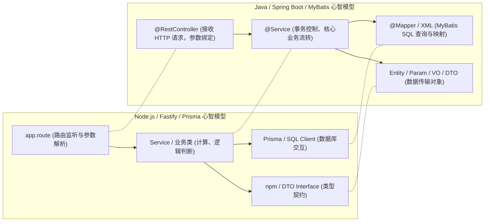

# 第 12 章 企业级微服务协同：读懂 Spring Cloud、Feign、租户隔离与 Spring AI 流式调用

> 预计学习时间：90–120 分钟  
> 一句话总结：全栈工程师的价值不在于死记某一种语言语法，而在于掌握系统工程的互通法则；破除对 Java 微服务的敬畏心，读懂 Controller 到 Mapper 的数据流向，消除 N+1 慢查询，并在企业既有架构中安全协同接入 AI 模块。

---

## 为什么全栈路线必须包含企业级 Java 协同能力

许多前端开发者在个人项目里能够用 Node.js 或 Python 搭建整套 AI 应用，但当他们进入真实的大中型企业（尤其是物流、航空、货运、金融等传统行业系统，例如典型的 `itran-cargoplus-cloud` 架构）时，往往会面临一面高耸的技术壁垒：
- **公司核心业务全部运行在 Java 微服务集群中**（Spring Boot 3、Spring Cloud Alibaba、Nacos、OpenFeign、MyBatis-Plus、RabbitMQ）；
- 前端提问接口需求时，经常得到后端的一句“这个改动牵扯分布式事务，或者租户上下文丢失了”，前端不知所云，陷入被动沟通；
- 公司需要接入 AI 能力时，要么由不懂交互的前端硬拼 API，要么由不熟悉流式长连接的传统后端机械封装，产物既卡顿又频发内存溢出。

> [!NOTE]
> 学习 Java 的目标**绝不是从头通读所有 Java 巨著或背诵 JVM 垃圾回收细节**，而是建立**心智映射模型**：能快速读懂现有调用链、排查跨服务 Bug、写出最小修改补丁，并与后端同事基于统一的工程标准无缝协作。

---

## 心智映射：从 Node.js/Fastify 到 Java/Spring Boot

Java 并不神秘，它与现代 TypeScript 服务端架构的底层思想完全一脉相承：



### 必须掌握的核心注解快速对照表

| Spring 注解 | 作用与对应的前端/Node 概念 | 常见排错与注意事项 |
| :--- | :--- | :--- |
| `@RestController` | 声明此类为 HTTP 控制器，方法默认返回 JSON（等同于 Fastify 路由处理器）。 | 确保路径前缀（`@RequestMapping`）未与网关路由规则冲突。 |
| `@Autowired` / `@Resource` | 依赖注入（IoC），自动装配 Service 或 Mapper 实例。 | 推荐使用构造器注入，防止空指针与循环依赖。 |
| `@Transactional` | 开启数据库事务（`BEGIN...COMMIT`）。 | **排错重点**：必须加 `(rollbackFor = Exception.class)`，且类内自调用（`this.method()`）会导致事务失效！ |
| `@PreAuthorize` | 接口权限拦截（如 `@PreAuthorize("hasAuthority('cargo:order:add')")`）。 | 校验失败直接抛出 403，排查无权限时优先查用户权限列表。 |

---

## 典型企业工程结构拆解 (以真实货运微服务为例)

在诸如 `itran-cargoplus-cloud` 等典型企业级微服务中，项目通常遵循严格的 `client / server` 分包规范：

```text
itran-cargoplus-cloud/
├── itran-common/            # 全局公共模块: BaseTenantEntity, Result/R, SecurityUtils, 统一异常
├── itran-gateway/           # 微服务网关: 路由分发、全局鉴权、限流、Token 传递
├── itran-modules/
│   ├── itran-cargo-client/  # 对外暴露的 OpenFeign 接口定义与 DTO 契约 (只放接口，不放实现)
│   └── itran-cargo-server/  # 真正的业务实现模块
│       ├── controller/      # 控制器: CargoOrderController.java
│       ├── service/         # 业务接口与实现: CargoOrderServiceImpl.java
│       ├── mapper/          # 数据持久层: CargoOrderMapper.java + Mapper.xml
│       └── dto/             # 参数对象: CargoOrderParam, CargoOrderVO (使用 MapStruct 转换)
└── itran-admin/             # 管理端模块 (通常内嵌 AI 对话服务: modules/ai)
```

### 实体分层分工（为什么绝不能直接把 Entity 返回给前端）
- **Entity**：直接映射数据库物理表的持久化对象（严禁直接返回给前端，防止泄露密码或内部版本号）。
- **Param / DTO**：前端向后端传递的入参对象（带有 `@NotNull`、`@Size` 校验注解）。
- **VO (View Object)**：专门序列化返回给前端展示的对象，通过 `MapStruct` 高性能转换，仅暴露前端所需字段。

---

## 核心避坑指南：识别并优化 N+1 循环查询

这是前端转全栈在阅读或编写 Java 后端代码时，最容易发现也是最值得重构的重大性能隐患：

```mermaid
flowchart TD
  subgraph 灾难写法: 循环内逐条查询 (N+1 问题)
    Q1["1. 执行 1 次 SQL: 查出 20 条运单列表 (SELECT * FROM cargo_order LIMIT 20)"] --> Loop["进入 Java for 循环遍历每一个运单"]
    Loop --> Q2["运单 1: SELECT * FROM cargo_detail WHERE order_id = 1"]
    Loop --> Q3["运单 2: SELECT * FROM cargo_detail WHERE order_id = 2"]
    Loop --> Q4["运单 ...: 产生 20 次网络 I/O 往返！总耗时激增 20 倍！"]
  end
  style Q4 fill:#faa,stroke:#333,stroke-width:1px

  subgraph 工业级重构: 收集 ID 批量查询并内存映射
    B1["1. 执行 1 次 SQL: 查出 20 条运单"] --> B2["2. Java Stream 收集 ID: List<Long> ids = orders.stream().map(Order::getId)..."]
    B2 --> B3["3. 执行第 2 次 SQL 批量拉取: SELECT * FROM cargo_detail WHERE order_id IN (1, 2, ...)"]
    B3 --> B4["4. 内存高效分组: Map<Long, List<Detail>> map = details.stream().collect(groupingBy...)"]
  end
  style B4 fill:#dfd,stroke:#333,stroke-width:1px
```

### 重构前后的 Java 代码对比

```java
// ❌ 存在严重 N+1 性能漏洞的代码
public List<CargoOrderVO> getOrderListWithDetailsBad() {
    List<CargoOrderEntity> orders = cargoOrderMapper.selectList(new QueryWrapper<>());
    List<CargoOrderVO> voList = new ArrayList<>();
    
    for (CargoOrderEntity order : orders) {
        CargoOrderVO vo = cargoOrderConverter.toVO(order);
        // 致命：在循环内频繁执行数据库查询，若查出 100 条运单则触发 101 次 SQL！
        List<CargoDetailEntity> details = cargoDetailMapper.selectList(
            new LambdaQueryWrapper<CargoDetailEntity>().eq(CargoDetailEntity::getOrderId, order.getId())
        );
        vo.setDetails(details);
        voList.add(vo);
    }
    return voList;
}

// ✅ 工业级高吞吐批量查询重构
public List<CargoOrderVO> getOrderListWithDetailsGood() {
    // 1. 单次查询获取运单主表
    List<CargoOrderEntity> orders = cargoOrderMapper.selectList(new QueryWrapper<>());
    if (orders.isEmpty()) return Collections.emptyList();

    // 2. 收集运单 ID 集合
    List<Long> orderIds = orders.stream()
            .map(CargoOrderEntity::getId)
            .collect(Collectors.toList());

    // 3. 单次批量查询所有关联子表记录 (WHERE order_id IN (...))
    List<CargoDetailEntity> allDetails = cargoDetailMapper.selectList(
        new LambdaQueryWrapper<CargoDetailEntity>().in(CargoDetailEntity::getOrderId, orderIds)
    );

    // 4. 在 JVM 内存中利用 Map 分组 (纳秒级耗时)
    Map<Long, List<CargoDetailEntity>> detailMap = allDetails.stream()
            .collect(Collectors.groupingBy(CargoDetailEntity::getOrderId));

    // 5. 高性能装配返回
    return orders.stream().map(order -> {
        CargoOrderVO vo = cargoOrderConverter.toVO(order);
        vo.setDetails(detailMap.getOrDefault(order.getId(), Collections.emptyList()));
        return vo;
    }).collect(Collectors.toList());
}
```

---

## 揭秘 Java 中的原生 AI 接入：Spring AI 与 Flux 流式服务

在现代企业微服务中（例如在 `itran-admin/modules/ai` 中），Java 团队通过 **Spring AI** 与 **Reactor WebFlux** 实现生产级流式响应。

你会发现其底层与我们在第 06 章讲的 SSE 完全一致：

```java
package com.itran.admin.modules.ai.controller;

import org.springframework.ai.chat.ChatResponse;
import org.springframework.ai.chat.prompt.Prompt;
import org.springframework.ai.openai.OpenAiChatModel;
import org.springframework.http.MediaType;
import org.springframework.web.bind.annotation.*;
import reactor.core.publisher.Flux;

@RestController
@RequestMapping("/admin/ai/chat")
public class AiChatController {

    private final OpenAiChatModel chatModel;

    public AiChatController(OpenAiChatModel chatModel) {
        this.chatModel = chatModel;
    }

    /**
     * 原生返回 text/event-stream 响应流！
     * 底层采用 Project Reactor 的 Flux 异步响应式流
     */
    @PostMapping(value = "/stream", produces = MediaType.TEXT_EVENT_STREAM_VALUE)
    public Flux<String> streamChat(@RequestBody ChatRequestDTO request) {
        Prompt prompt = new Prompt(request.getMessage());
        
        // 异步非阻塞流式吐出每一个 Chunk
        return chatModel.stream(prompt)
                .map(chatResponse -> {
                    String content = chatResponse.getResult().getOutput().getContent();
                    return content != null ? content : "";
                })
                .doOnError(err -> {
                    // 监听流式异常日志
                    log.error("Spring AI 流式输出发生异常", err);
                });
    }
}
```

读懂这段代码，你会立即顿悟：**无论语言是 TypeScript 还是 Java，前端消费端接到的依然是标准的 SSE `text/event-stream`！前端用第 06 章封装的 `useChatStream` Hook，不需要做任何改动，就能无缝对接 Java 后端流式服务！**

---

## 协同排错自检清单

当你在企业日常开发中配合后端排查接口 Bug 时，请按以下顺序形成闭环证据链：

- [ ] **多租户隔离检查**：当前请求经过网关时，请求头 `tenant-id` 是否丢失？`TenantContext.getTenantId()` 是否在多线程异步调用中变成了 `null`？
- [ ] **事务回滚有效性**：查看 Service 方法上的 `@Transactional` 是否注明了 `rollbackFor = Exception.class`，内部是否误用 `try...catch` 把异常私自吞掉？
- [ ] **Feign 跨服务超时**：微服务调用链中是否由于某一个下游服务阻塞（如调用外部慢速大模型），导致 Nacos 网关触发 `ReadTimeout: 5000ms` 降级？
- [ ] **SQL 与分页性能**：通过日志检查最终执行的 SQL 语句，是否出现了循环 N+1 查询？分页是否走上了索引？

---

## 终章小结：打造你的高含金量 AI 全栈作品集

学完本课程后，你已经从单纯的“页面交互编写者”，蜕变成为了兼具**产品感知、服务端架构、存储与向量、高并发护城河、工业级 RAG 检索、受控 Agent 以及跨语言团队协作能力**的生产级 AI 全栈工程师。

不要在简历上罗列枯燥的技术名词，带着你贯穿全书打造的实战项目：
> **“带权限的企业知识库 AI 助手（Enterprise Knowledge Copilot）”**
- 附带严密的数据库架构设计图与 DDL；
- 附带 30 组黄金评测集的 Faithfulness 自动化质量度量报告；
- 附带一份防范 Prompt 注入与悲观行锁防超卖的故障演练复盘记录；
- 附带容器化一键部署编排文件与 CI/CD 质量流水线。

这才是你在 AI 时代最坚实、最具说服力的专业工程底色！
