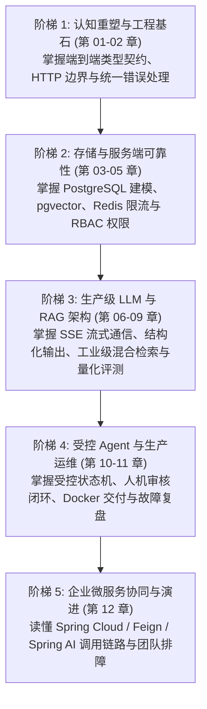

# 课程全景蓝图 (COURSE-BLUEPRINT)

本蓝图详细规划《前端转 AI 全栈：从交互体验到生产级交付》全书 12 门核心章节的知识地图、先修依赖、自有学习路径、代码证据及验收标准。

---

## 一、知识地图与能力梯次规划

全课程按认知与工程演进划分为 5 个能力阶梯，严禁出现前置知识断层：

- **全书 20%–30% 核心深度章节**：
  - **第 03 章**：PostgreSQL 关系建模与 pgvector 向量检索机制（存储是全栈基石）
  - **第 06 章**：生产级 LLM 服务：SSE 流式长连接与 AbortSignal 熔断（AI 体验与成本的分水岭）
  - **第 08 章**：工业级 RAG 检索管线：混合检索、重排与权限过滤（AI 业务落地核心架构）
  - **第 09 章**：RAG 黄金评测集与成本可观测性（工程化而非“凭感觉”的关键证明）

---

## 二、逐章设计蓝图 (Chapter Blueprints)

### 第 01 章：认知重塑：为什么会调用 API 不等于 AI 全栈

- **所属模块**：模块 1 · 认知重塑与端到端工程基石
- **正文主类型**：`opening-closing`（开篇认知型）
- **讲师风格**：严谨技术型 + 简洁专业型
- **前置知识**：熟练 React 开发，曾使用前端 fetch 调过模型接口。
- **核心问题**：“为什么在前端直接调 LLM 接口上线后，会在几小时内被打穿、产生天价账单并引发安全灾难？”
- **自有学习路径**：
  1. 复盘一起真实的“前端直连 OpenAI Key”事故现场：密钥泄漏、Token 额度被盗刷万刀、敏感数据越权返回。
  2. 剖析“玩具 Demo”与“生产级 AI 系统”的本质差异：数据边界、安全鉴权、并发幂等、成本与可观测性。
  3. 建立“四层能力模型”：产品交付层、服务工程层、AI 工程层、生产运营层。
  4. 明确个人转型技术路线：主线 TypeScript + Fastify 打通全链路闭环，副线 Python 支撑科学评测。
  5. 明确贯穿全课程的主战项目：“带权限的企业知识库 AI 助手（Enterprise Knowledge Copilot）”演进路线。
- **代码与证据支撑**：生产事故架构缺陷图对比、四层能力验收自查矩阵。
- **课后验收证据**：能够用架构图画出自己当前系统的安全漏洞，并陈述必须服务端化的 5 个理由。

---

### 第 02 章：服务端工程基石：REST 规范、参数校验与端到端类型契约

- **所属模块**：模块 1 · 认知重塑与端到端工程基石
- **正文主类型**：`framework`（服务端框架应用型）
- **讲师风格**：耐心教练型 + 严谨技术型
- **前置知识**：TypeScript 基础，理解 HTTP GET/POST、Query、Body。
- **核心问题**：“如何利用 TypeScript 从前端到后端实现 100% 类型安全，不写重复的类型定义且杜绝运行时脏数据？”
- **自有学习路径**：
  1. 从前端开发者最熟悉的 `fetch` 出发，剖析后端不加输入验证造成的 SQL 注入与服务端崩溃。
  2. 引入 Fastify 与 `Zod` / `@sinclair/typebox`，讲解“编译期类型”与“运行时 Schema 校验”的统一。
  3. 设计生产级 RESTful API：路由命名规范、分页（Cursor vs Offset）、HTTP 语义状态码与幂等设计。
  4. 封装统一服务端响应结构 `Result<T>` 与全局异常拦截器（捕获未捕获 Promise 异常与业务异常）。
  5. 演示前后端类型共享（Monorepo 或共享 `npm/types` 包），实现后端改字段、前端自动编译报错。
- **代码与证据支撑**：Fastify 初始化脚本、Zod 参数验证中间件、统一全局 Error Handler、端到端测试。
- **课后验收证据**：提交一个带严格入参校验、统一错误响应与自动化测试用例的 Fastify 独立 API。

---

### 第 03 章：核心数据存储：PostgreSQL 关系建模、事务与 pgvector 向量扩展 (深度章)

- **所属模块**：模块 2 · 后端工程与核心存储
- **正文主类型**：`framework`（数据库框架应用型）
- **讲师风格**：严谨技术型 + 实践带练型
- **前置知识**：基础 SQL 语法（SELECT / INSERT），理解表和字段概念。
- **核心问题**：“为什么企业级 AI 应用优先选用 PostgreSQL + pgvector，而不是立刻堆一套专用向量数据库？”
- **自有学习路径**：
  1. 架构取舍分析：专用向量数据库（Pinecone/Milvus）vs 关系型向量插件（pgvector）在事务、备份与权限关联上的优劣对比。
  2. 搭建 PostgreSQL 16 实例并启用 `pgvector` 扩展。
  3. 业务数据模型设计：用户表、文档知识库表、切片表（Chunks）、向量索引字段、审计日志表。
  4. 数据库可靠性基石：主键、外键约束、B-Tree 索引、唯一约束与数据库迁移管理（Prisma / Drizzle）。
  5. 事务并发控制：转账扣减/Token 配额扣减时的并发竞争问题，`BEGIN ... COMMIT` 与悲观锁 `FOR UPDATE`。
  6. pgvector 索引进阶：HNSW（分层导航小世界）与 IVFFlat 索引的区别、距离度量（Cosine vs L2）与检索性能实测。
- **代码与证据支撑**：DDL 建表脚本、带有 HNSW 索引的向量表结构、事务扣减配额的 TypeScript 代码。
- **课后验收证据**：运行一段并发扣减 Token 余额脚本，证明通过事务锁杜绝了超额扣费，并通过 `EXPLAIN ANALYZE` 验证 HNSW 索引生效。

---

### 第 04 章：高并发护城河：Redis 缓存穿透防御、滑动窗口限流与轻量任务队列

- **所属模块**：模块 2 · 后端工程与核心存储
- **正文主类型**：`mechanism-diagnostics`（机制诊断型）
- **讲师风格**：案例分析型 + 严谨技术型
- **前置知识**：Key-Value 存储概念，理解内存缓存速度优势。
- **核心问题**：“在高并发刷量和慢速 AI 接口调用下，如何防止数据库被打垮以及模型账单被刷爆？”
- **自有学习路径**：
  1. 还原三种经典缓存灾难：缓存穿透、缓存击穿、缓存雪崩，给出工业级防御方案（布隆过滤器 / 互斥锁 / 随机过期）。
  2. 接口防刷与防御性限流：固定窗口与漏桶算法的不足，使用 Redis Sorted Set (ZSET) + Lua 脚本实现原子性滑动窗口限流。
  3. API 幂等性控制：客户端生成 `Idempotency-Key`，服务端基于 Redis 实现 5 分钟防重复提交。
  4. 异步解耦初探：利用 Redis Streams 或 BullMQ 实现轻量级文档向量化任务队列，剥离主 HTTP 响应路径。
- **代码与证据支撑**：滑动窗口限流 Lua 脚本、Redis 幂等中间件、BullMQ 生产者与消费者异步处理代码。
- **课后验收证据**：用压测工具连续发送 100 次并发请求，证明在限流阈值内正常放行，超限请求被毫秒级拦截并返回 `429 Too Many Requests`。

---

### 第 05 章：生产级安全防护：JWT 认证、RBAC 细粒度权限与 AI 注入防御

- **所属模块**：模块 2 · 后端工程与核心存储
- **正文主类型**：`framework`（安全工程型）
- **讲师风格**：严谨技术型
- **前置知识**：HTTP Header、Cookie、跨域机制。
- **核心问题**：“如何保证用户只能查到属于自己部门的知识库，并防御恶意的 Prompt 注入攻击？”
- **自有学习路径**：
  1. 前端常见的伪安全误区：只在前端根据角色隐藏按钮，后端接口完全不校验。
  2. 工业级认证方案：Access Token（短效，内存/Header）+ Refresh Token（长效，HttpOnly Cookie）双令牌轮转。
  3. 细粒度 RBAC 权限设计：用户 - 角色 - 权限 - 知识库租户空间，实现多租户数据物理/逻辑隔离。
  4. AI 专属安全威胁：直接注入（Jailbreak / Ignore previous instructions）、间接注入（恶意网页/PDF 隐藏指令）、越权数据检索。
  5. 纵深防御实战：System Prompt 锚定、输入敏感词与注入特征正则预过滤、知识库检索服务端强行拼接 `tenant_id` 与 `user_id` 过滤条件。
- **代码与证据支撑**：Fastify JWT 鉴权中间件、基于 SQL `WHERE tenant_id = ?` 的防越权检索实现、Prompt 防注入过滤函数。
- **课后验收证据**：模拟跨租户请求被严格拒绝返回 `403 Forbidden`，并模拟黑客注入 Payload 被安全拦截。

---

### 第 06 章：生产级 LLM 服务：SSE 流式长连接、AbortSignal 实时中断与代理网关 (深度章)

- **所属模块**：模块 3 · 生产级 LLM 应用开发
- **正文主类型**：`framework`（核心机制应用型）
- **讲师风格**：严谨技术型 + 耐心教练型
- **前置知识**：JavaScript Generator / Async Iterable，HTTP 传输机制。
- **核心问题**：“前端点击‘停止生成’时，为什么你的服务端和 OpenAI 还在持续计费？如何搭建一个生产级流式网关？”
- **自有学习路径**：
  1. 为什么 AI 必须使用流式输出：TTFT（首字到达时间）从 10 秒骤降至 500 毫秒的产品心理学。
  2. 深度拆解 SSE（Server-Sent Events）协议规范：`text/event-stream`、`id`、`event`、`data: [DONE]` 机制。
  3. 服务端代理转发：如何安全调用上游 OpenAI / Google Gemini 接口，将密钥完全隔离在服务端。
  4. 致命漏洞排查：前端 `fetch.abort()` 断开后，Node.js 服务端必须监听 `request.raw.on('close')` 并触发 `AbortController.abort()`，立即终止上游模型推理，避免 Token 持续浪费。
  5. 流式输出中的网络异常重连与断点拼接策略。
- **代码与证据支撑**：Fastify SSE 端点实现、带有 AbortSignal 传递的 OpenAI SDK 调用、前端 React `useChatStream` 自定义 Hook 源码。
- **课后验收证据**：演示在流式生成第 30 个字时点击“停止”，服务端后台日志立即输出“Upstream Aborted”，上游请求立即释放。

---

### 第 07 章：结构化输出与受控工具调用：Zod Schema 校验与业务逻辑闭环

- **所属模块**：模块 3 · 生产级 LLM 应用开发
- **正文主类型**：`framework`（数据闭环型）
- **讲师风格**：实践带练型 + 严谨技术型
- **前置知识**：JSON Schema，函数入参与返回值。
- **核心问题**：“如何让自由散漫的自然语言模型 100% 可靠地输出符合业务系统入参的强类型 JSON 实体？”
- **自有学习路径**：
  1. 正则解析与自然语言提取的脆性分析：为什么 Prompt 里写“请务必只返回 JSON”依然会频繁产生 Markdown 代码块导致崩溃。
  2. OpenAI Structured Outputs 与 JSON Mode 机制深潜：基于受限生成（Constrained Decoding）的底层原理。
  3. 使用 Zod 定义业务实体 Schema，将其自动编译为 JSON Schema 并传入模型配置。
  4. Tool Calling / Function Calling 机制：从模型意图识别、提取参数、服务端执行本地函数、再将结果回传给模型的完整闭环。
  5. 错误自愈循环：当模型生成的内容偶发校验失败时，如何通过将校验错误信息重新追加至上下文触发自动修复（Self-Correction）。
- **代码与证据支撑**：Zod 业务模型定义、OpenAI `response_format: json_schema` 示例、Function Calling 工具调度路由与自愈逻辑。
- **课后验收证据**：编写自动化测试，调用模型提取 20 篇杂乱文本中的订单信息，做到 100% 成功解析为 Zod 类型对象，解析失败率为 0。

---

### 第 08 章：工业级 RAG 检索管线：清洗切分、混合召回、重排与权限隔离 (深度章)

- **所属模块**：模块 4 · 企业级 RAG 架构与质量评测体系
- **正文主类型**：`integrated-practice`（核心架构综合实战型）
- **讲师风格**：严谨技术型 + 实践带练型
- **前置知识**：第 03 章 pgvector，理解 Embedding 概念。
- **核心问题**：“为什么‘简单把文档切碎扔进向量库’做出的 RAG 在生产中经常胡说八道？工业级 RAG 究竟包含哪些关键工序？”
- **自有学习路径**：
  1. 玩具 RAG 破灭录：切分破坏语义、单向量召回偏科（专有名词搜不准）、无关噪音导致上下文污染。
  2. 文档预处理与智能切分：递归字符切分（RecursiveCharacterTextSplitter）、Markdown 标题感知切分与元数据附着（文件名、章节层级、时间）。
  3. 混合检索（Hybrid Search）：PostgreSQL 全文搜索（Full-Text Search `tsvector`，擅长精准型号/代码）+ pgvector 语义检索（擅长同义词意图）的双路召回。
  4. 互惠排名融合（RRF, Reciprocal Rank Fusion）与 Cross-Encoder Rerank 重排模型接入，剔除 Top-K 中的幻觉噪音。
  5. 权限隔离：在向量检索 SQL 中强制添加 `WHERE department_id IN (...)`，从物理层杜绝财务涉密文档被普通员工搜出。
  6. 来源可溯源（Citations）：在最终流式输出中携带 Chunk 的真实段落与文档引用，前端支持划词溯源高亮。
- **代码与证据支撑**：Markdown 递归分块代码、PostgreSQL 混合检索 SQL、RRF 算法实现、带引用的 Prompt 组装模块。
- **课后验收证据**：导入一份包含产品技术规格与专有名词的文档，验证混合检索召回率明显超越纯向量检索，且前端准确展示角标引用链接。

---

### 第 09 章：从“感觉不错”到数据量化：RAG 黄金评测集与成本可观测性 (深度章)

- **所属模块**：模块 4 · 企业级 RAG 架构与质量评测体系
- **正文主类型**：`mechanism-diagnostics`（评测工程型）
- **讲师风格**：案例分析型 + 严谨技术型
- **前置知识**：第 08 章 RAG 架构，基础 Python 脚本阅读能力。
- **核心问题**：“每次修改 Prompt 或换了一个 Embedding 模型，如何证明整体问答质量是提升了还是劣化了？”
- **自有学习路径**：
  1. 摒弃作坊式评测：“我试了三个问题感觉挺好”绝不是工程交付标准。
  2. 搭建黄金评测集（Gold Dataset）：包含三类核心样本——常规正向问答、边界模糊问答、必须明确拒答的“无法依据知识库回答”用例。
  3. 掌握 RAGAS 核心评价指标体系：
     - 上下文相关度（Context Relevance）
     - 答案保真度（Faithfulness，无幻觉生成）
     - 答案相关度（Answer Relevance）
     - 拒答准确度（Negative Rejection Rate）
  4. 自动化回归评测流水线：利用 Python 副线脚本自动化跑测，生成 CI/CD 质检雷达图与得分报告。
  5. 成本与延迟可观测性：在服务端记录每次检索耗时、Embedding 耗时、LLM 首字延迟（TTFT）、Prompt/Completion Token 计数并计算单次问答毛利。
- **代码与证据支撑**：黄金测试集 JSON 数据集、Python + Ragas 评测脚本、Prometheus/结构化日志计费监控代码。
- **课后验收证据**：提供一份自动化生成的包含至少 30 个用例的评测报告，清晰对比参数调整前后的 Faithfulness 与 Context Precision 指标。

---

### 第 10 章：受控业务 Agent：状态机、工具白名单与 Human-in-the-Loop 审核机制

- **所属模块**：模块 5 · 受控 Agent 架构与生产运维
- **正文主类型**：`integrated-practice`（高级架构综合实战型）
- **讲师风格**：严谨技术型 + 实践带练型
- **前置知识**：第 07 章 Tool Calling，异步任务状态管理。
- **核心问题**：“为什么自主 Agent（AutoGPT 类）在企业中无法落地？如何设计安全、可靠、可控的受控业务 Agent？”
- **自有学习路径**：
  1. 失控的代价：无限循环死锁、Token 账单爆炸、模型私自调用写入/删除接口引发真实灾难。
  2. 受控架构设计哲学：有限状态机（FSM）严格限定 Agent 执行步数（`max_steps = 5`）、超时熔断与回滚机制。
  3. 工具权限三级白名单：
     - 级别 1（安全只读）：查询知识库、查看工单列表（模型可自动执行）。
     - 级别 2（轻度写入）：创建待办任务、更新个人资料（需提供预校验）。
     - 级别 3（高风险破坏性）：数据库删除、退款支付、生产部署（强制挂起，等待人工审核）。
  4. 人机协同（Human-in-the-Loop）：当模型触发级别 3 工具时，Agent 进入 `PENDING_APPROVAL` 挂起状态并向审批人推送通知；人工确认后携带签名恢复执行。
  5. 执行轨迹（Trace）可视化：前端完整展现 Agent 思考（Thought）、调工具（Action）、观察（Observation）全过程。
- **代码与证据支撑**：基于 TypeScript 的受控 Agent 状态机、工具安全拦截器、人机审核中继与状态持久化代码。
- **课后验收证据**：演示当 Agent 尝试执行退款工具时，系统精准在前端弹出审核卡片，拒绝后 Agent 优雅降级并回复用户拒绝理由。

---

### 第 11 章：容器化交付、CI/CD 自动化部署与生产环境故障复盘

- **所属模块**：模块 5 · 受控 Agent 架构与生产运维
- **正文主类型**：`environment` + `integrated-practice`（运维与高可用实战型）
- **讲师风格**：实践带练型 + 案例分析型
- **前置知识**：基础 Linux 命令行，Git 工作流。
- **核心问题**：“在本地跑得好好的全栈 AI 项目，如何打包上线并抵御真实生产环境的网络断连与崩溃？”
- **自有学习路径**：
  1. 容器化最佳实践：编写多阶段构建的 Node.js/Fastify `Dockerfile`，体积从 1.2GB 缩减到 120MB，配置 non-root 用户杜绝容器逃逸。
  2. Docker Compose 本地一键编排：统一拉起 App、PostgreSQL (pgvector) 与 Redis，实现开发环境与生产环境一致。
  3. GitHub Actions CI/CD 流水线：自动化代码检查、运行 Jest/Vitest 单元测试、构建镜像并推送。
  4. 生产可用性保障：容器健康检查（Healthcheck `/healthz`）、优雅停机（Graceful Shutdown）、未处理拒绝（Unhandled Rejection）告警。
  5. 数据库平滑迁移与回滚演练：生产环境 `db:migrate` 步骤与应急 `down` 回滚演练。
  6. 生产故障复盘规范（Post-mortem）：如何按“时间线 → 故障根本原因 → 止损措施 → 改进项（Action Items）”撰写生产级复盘文档。
- **代码与证据支撑**：多阶段 Dockerfile、docker-compose.yml、GitHub Actions workflow yaml 文件、标准生产事故复盘模板。
- **课后验收证据**：应用可在独立服务器上一键 Docker 部署启动并通过健康检查，并提交一份模拟“数据库连接池耗尽”的真实故障复盘报告。

---

### 第 12 章：企业级微服务协同：读懂 Spring Cloud、Feign、租户隔离与 Spring AI 流式调用

- **所属模块**：模块 6 · 实战延伸与企业微服务协同
- **正文主类型**：`language` + `mechanism-diagnostics`（语言与企业微服务协同型）
- **讲师风格**：案例分析型 + 耐心教练型
- **前置知识**：掌握前面 11 章的全栈思想；面向在企业现有 Java 后端环境中工作的全栈转型者。
- **核心问题**：“在公司真实的 Java 微服务体系（Spring Cloud Alibaba、Feign、Nacos）中，前端转全栈如何快速看懂后端代码、排查跨端 Bug 并协同接入 AI 模块？”
- **自有学习路径**：
  1. 破除语言壁垒：Java 并不神秘，建立 Spring Boot 三层架构与 Express/Fastify 的心智映射（`Controller` ≈ Router, `Service` ≈ 业务逻辑, `Mapper` ≈ ORM/DAO）。
  2. 剖析真实企业工程结构（以 `itran-cargoplus-cloud` 典型货运微服务为例）：读懂 `client`（Feign 跨服务客户端）与 `server`（业务实现）、MapStruct 实体转换与统一响应 `Result<T>` / `R<T>`。
  3. 杜绝最常见的性能与业务灾难：识别循环内逐条查询 SQL（N+1 问题），学会将其重构为“收集 ID → 批量查询 → 内存 Map 映射”；理解 `@Transactional` 回滚边界与跨多租户 `TenantContext` 丢失陷阱。
  4. 揭秘 Java 中的 AI 原生实现：阅读 `itran-admin/modules/ai`，拆解 `AiModelFactory`、基于 WebFlux `Flux` 与 `TEXT_EVENT_STREAM` 的流式长连接原理。
  5. 掌握 AI 辅助后端的安全边界：如何写出最小差异的提示词让 AI 解释调用链，禁止盲目全量重写；排查跨网关超时与 Nacos 配置漂移。
- **代码与证据支撑**：Spring Boot Controller 到 Mapper 链路剖析图、N+1 重构前后对比代码、Spring AI Flux 流式端点源码与测试用例。
- **课后验收证据**：拿出一个包含真实 Bug 的脱敏 Java 代码片段（如事务未回滚、流式中途断开未持久化），在 15 分钟内准确定位根因并提供最小修复补丁。
