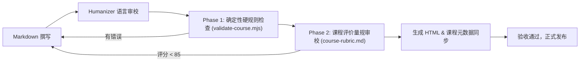

# 课程生成规格说明书 (COURSE-GENERATION-SPEC)

本规格说明书定义《前端转 AI 全栈：从交互体验到生产级交付》全课程的工程规范、文字与代码排版标准、质检指标及验收交付红线。

---

## 一、课程基础规格

- **课程全称**：前端转 AI 全栈：从交互体验到生产级交付
- **英文标识 (slug)**：`frontend-to-ai-fullstack`
- **课程章节总数**：12 章主线章节 + 2 篇参考附录（术语表、生产检查清单）
- **章节有效字符数要求**：
  - 核心机制与架构实战章：建议 4,000 – 9,000 字符（高密度实战、图表与排错代码）。
  - 开篇与总结认知章：建议 3,000 – 6,000 字符（重构认知模型、建立演进地图）。
  - 质检硬性下限：每章正文纯文本有效字数不得低于 1,500 字符（排除代码后），确保机制讲透。
- **交付格式**：
  - Markdown 事实源（保存在 `lessons/` 目录下）。
  - 课程元数据（保存在 `course.json`）。
  - 课程主页（根目录 `index.html`）。
  - 辅助参考手册（保存在 `reference/` 目录下）。

---

## 二、受众约束与讲师语言风格

### 1. 基础讲师风格：严谨技术型 + 耐心教练型
- **严谨技术型**：对接口幂等性、SQL 索引原理、事务 ACID、SSE 长连接协议、Token 计费与权限隔离给出清晰、可量化的技术定义；不搞模糊定性，拒绝“大约”、“可能行”。
- **耐心教练型**：站在前端工程师的已知视角（熟练处理 React 状态、Promise 链式调用、网络请求）出发，逐步引导理解后端连接池、数据一致性与服务端守护进程。不使用居高临下的说教词汇（如“显然”、“极其简单”、“小学生都会”）。

### 2. 人性化表达规范（基于 Humanizer-zh 准则）
- **禁止宣传腔与假大空**：禁止使用“革命性变革”、“史诗级飞跃”、“震撼登场”等浮夸修饰词。
- **禁止空洞三段式结论**：每个章节总结必须落实为可执行的代码、可复查的排错清单或可验证的测试用例。
- **杜绝 AI 常见套话**：禁止在文末无脑输出“总而言之，在未来的日子里，只要我们不断学习……”。
- **自然且有针对性**：以多年后端与全栈架构师的一线排错经验为口吻，还原真实踩坑现场（如：连接池被打爆、Token 计费超支几千美金、Prompt 注入被脱库等真实惊险案例）。

---

## 三、代码与技术排版规范

1. **代码真实可用性**：
   - 所有代码片段必须声明明确的语言标签（如 ````typescript````, ````sql````, ````json````, ````bash````, ````dockerfile````, ````java````）。
   - 禁止在关键执行路径上留下 `// TODO: 这里自己写` 等敷衍注释；必须提供完整的核心逻辑与防御性错误处理。
2. **图表绘制规范**：
   - 系统架构、数据流与调用链路必须使用标准 Mermaid 图绘制。
   - 允许使用的图类型：`flowchart TD` / `flowchart LR`, `sequenceDiagram`, `stateDiagram-v2`。
   - **绝对禁止使用 Mermaid `mindmap` 类型**（根据 `validate-course.mjs` 规则，mindmap 属于确定性质检硬错误）。
3. **结构化表格对比**：
   - 凡涉及 3 种以上方案选型、设计模式或错误状态码对比，必须采用 Markdown 规范表格呈现。
4. **核心术语强调**：
   - 关键专有名词、安全警示或踩坑经验必须使用 GitHub 风格引用块（`> [!TIP]`, `> [!WARNING]`, `> [!IMPORTANT]`）高亮强调。

---

## 四、安全与合规红线

- **绝对禁止硬编码任何敏感凭证**：API Key、数据库密码、Token 密钥一律使用 `process.env.XXX` 或假占位符（如 `sk-proj-demo-placeholder-token`）。
- **杜绝泄漏内部私有信息**：禁止泄漏公司内网专用 IP（如 `10.x.x.x` 内部真实路由）、私有开发机用户名、私有项目特定未授权源码。
- **防注入与权限最小化**：所有涉及用户输入的地方，必须包含输入清洗与参数化查询（Parameterized Query / Prepared Statements），严禁出现 SQL 字符串拼接示例。

---

## 五、质量验收与发布流程门禁

每章内容在合并并发布至最终交付产物前，必须按顺序通过以下质量闸门：



1. **确定性检查 (Phase 1)**：运行 `validate-course.mjs`，实现 `0 error`（检查目录完整性、代码块闭合、无禁用 Mermaid 图、本地链接完备、外部链接合规）。
2. **量规审校 (Phase 2)**：依照 `references/course-rubric.md` 进行六维评估，加权得分必须 `>= 85 分`，且不存在任何 Blocker 项。
3. **元数据一致性**：`course.json` 中登记的章节编号、标题、预计时长、概要必须与实际文件完全吻合。
